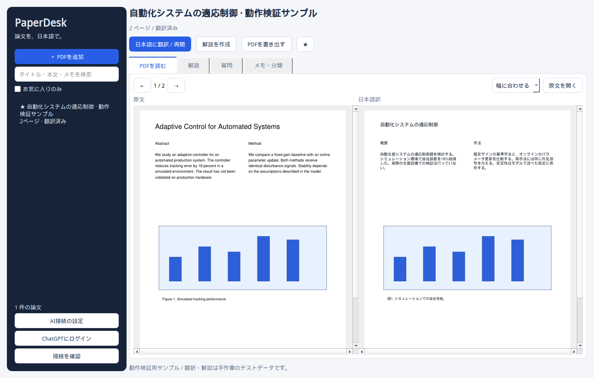

# PaperDesk for Windows

段・ページをまたぐ本文：ページの列配置から読み順を復元し、文が続いている根拠のある隣接ブロックを結合して一度だけ翻訳します。訳文は句読点などで元の領域に配分し、数式は元ページの画像を使います。ページを指定した場合、同じ文を共有する関連ページも翻訳対象に含め、進捗とレポートに記録します。見出し・独立数式・図表・参考文献をまたぐ曖昧な結合は行いません。`document.json` の `continuations` と `continuation_decisions` で採用・見送りを確認できます。3段以上や複雑な混在レイアウトは対応範囲外です。

新規翻訳による検証も関連ページをまとめて生成します。共通の文を含むページは同時に反映する必要があり、片方だけの差し替えやページ間で異なる共通訳文は拒否します。

検証ページの反映：画像を確認後、`python -m tools.apply_layout_review --papers <論文フォルダー> --review <検証出力フォルダー> --case 論文IDの先頭:ページ番号` で指定ページをライブラリへ反映できます。`--case` を省略すると、その検証で完了した全ページを反映します（未完了の検証は明示的なページ指定が必要です）。`translated.pdf` の該当ページ、`interleaved.pdf`、存在する場合の `bilingual.pdf`、訳文Markdown、抽出情報・キャッシュ・翻訳済みページ情報を更新します。対象外ページは現在表示される内容を維持します。変更前のファイルは論文フォルダー内の `review-backups` に保存します。抽出形式が変わって対応しなくなった古いキャッシュはバックアップに残し、新しい抽出情報に合う訳文だけを登録します。反映中はアプリから同じ論文の翻訳を実行しないでください。反映後は論文を選び直してください。

レイアウトの目視検証には `python -m tools.review_fresh_layout --papers <論文フォルダー> --output <新しい出力フォルダー> --seed 20260916 --count 3` を使えます。毎回 `original.pdf` を現在の処理で抽出し、選んだページをAIで新規翻訳します。既存の `translated.pdf`・抽出情報・翻訳キャッシュは読みません。出力には原文と訳文のPNG、対訳PDF、ページ番号・原文のハッシュ・描画結果を記録した `manifest.json` が含まれます。特定ページを検証する場合は `--case 論文IDの先頭:ページ番号` を指定できます（複数指定可）。既存の出力フォルダーへの上書きは拒否します。翻訳の接続設定を使用するため、通常の翻訳と同じモデル利用枠を消費します。

参考文献の保持：References・Bibliographyなどの見出し以降を候補とし、出版年、行頭の[2]形式の番号、引用符で囲まれた題名、3件以上の文献番号の連番（1.・1)・1形式）、DOIなどのOR条件を確認できたブロックだけ原文のまま保持します。ページをまたいでも判定を続け、Appendixなどの見出しで候補範囲を終了します。数字や記号だけでは除外せず、判断が曖昧な文献・折り返し部分は翻訳対象に残します。既存PDFは再翻訳時に反映され、翻訳対象が変わるとキャッシュが更新されます。判定理由はdocument.jsonのreference_evidence、保持したIDはtranslation-report.jsonのpreserved_reference_blocksで確認できます。

表の保持：罫線付きの表と横罫線だけの表を検出し、セル内を翻訳対象から外して原文の配置・文字・罫線を保持します。表題と周囲の本文は翻訳対象です。罫線のない表は現在の自動検出の対象外です。既存PDFは再翻訳時に抽出情報が更新されます。表の検出で翻訳単位が変わった文書では翻訳キャッシュが更新され、本文の再翻訳が発生します。生成済みPDFの表示を更新するには再翻訳してください。

PDFの日本語訳・原文との左右表示・解説・本文を参照する質問・論文管理を備えた、Windows向けの初版です。miniscoの主要な使い方を参考に、PythonとQtで独立実装しました。

**ソースコードと起動スクリプトを同梱しています。Windows実機での起動、実際のChatGPT/API接続、Windows用exeのビルドは未検証です。** Linux上でバックエンド12項目と画面の操作テストを実施しました。AI部分のテストには模擬応答を使用しています。



画面・対訳PDFのサンプルは架空の論文です。翻訳・解説には手作業のテストデータを使っています。

## 最初に起動する

対象環境：Windows 11 x64、Python 3.12 x64を推奨。GPUとDockerは必須ではありません。初回セットアップにはインターネット接続が必要です。

1. ZIPをフォルダーへ展開します。ZIP内から直接実行しないでください。
2. [Python公式サイト](https://www.python.org/downloads/windows/)からPython 3.12 x64をインストールします。Python Launcher、または「Add python.exe to PATH」を有効にしてください。すでにPython 3.11以降があれば、セットアップはその利用も試みます。
3. `setup.cmd`をダブルクリックします。専用の`.venv`環境に依存ライブラリを導入します。
4. 完了後、`start.cmd`をダブルクリックします。
5. 左側の「PDFを追加」で、手元の論文を選びます。

追加・原文閲覧・メモ・分類・検索は、AI接続前でも使えます。初期動作の確認には`tests/fixtures/sample.pdf`を利用できます。

PDFは左側のフォルダーツリーから開きます。「メモ・整理」タブの「フォルダー」に名前を入力して保存すると分類でき、`制御工学 / 読書会`のように`/`で区切ると入れ子になります。フォルダーを選んだ状態で追加したPDFは、そのフォルダーへ入ります。以前のコレクション名も同じ階層として自動表示されます。

PDFを右クリックして「分類を変更」から既存の分類や「未分類」を選べます。「新しい分類を入力…」ではサブフォルダーも指定できます。ツリー内のPDFは、移動先フォルダーへドラッグ＆ドロップして分類を変更できます。閉じたフォルダーにしばらく重ねると展開します。エクスプローラーからフォルダー上へPDFをドロップすると、その分類へコピーして追加します（同一PDFは従来どおり重複追加せず、既存の分類を維持します）。

ツリーの余白や「未分類」を右クリックしてフォルダーを作成できます。フォルダーの右クリックからは子フォルダーを作成できます。右クリックやドラッグでの分類移動は、画面下の「移動を戻す」で今回の起動中の操作を順に取り消せます。「メモ・整理」での保存はこの取り消しの対象外です。

PDFごとの最終閲覧ページを記憶し、起動時は前回のPDFから再開します。「ページへ移動」に原文のページ番号を入力し、Enterまたは「移動」で直接開けます（「翻訳済みページのみ」からは「全ページ」に切り替わります）。検索時は一致したフォルダーを展開し、解除すると元の開閉状態に戻ります。Ctrl+Lで条件を解除し、読んでいるPDFの場所へ移動できます。

ショートカットは `←` / `→` で前後のページへ移動、`Ctrl+O` でPDF追加、`Ctrl+F` で検索、`Ctrl+G` でページ指定、`Ctrl+L` で閲覧中のPDFへ移動です。矢印キーによるページ移動はPDF閲覧時に使え、文字入力中はカーソル操作を優先します。AI設定・ログイン・接続確認は左下の「接続・設定」にまとめています。

「接続・設定」→「AI接続の設定」の「推論の強さ（effort）」で、既定値・low・medium・high・xhighを選べます。設定は再起動後も保持します。「既定値」は追加パラメーターを送らず、従来の接続先の設定を使います。選択値は翻訳・解説・質問の新しいAI処理に適用され、翻訳済み部分のキャッシュは維持します。モデルや互換APIが非対応の場合は「既定値」を使ってください。

翻訳開始画面では、ページ範囲と一緒に `sol-medium：普段の全文翻訳用`、`sol-high：難解な理論・証明用`、`terra-medium：多数の論文向け・品質とAPI費用のバランス重視` を選べます。「AI接続の設定をそのまま使う」も選択できます。選択は翻訳にのみ適用し、前回開始した際の選択を記憶します。接続先と解説・質問の設定は変わりません。ページごとに翻訳時のコード識別値（SHA-256）を保存します。識別値は起動時に翻訳・AI通信・PDF抽出／生成に関わるPythonソースから自動計算するため、未コミットの変更も反映され、手動のバージョン更新は不要です。コード変更後はアプリを再起動してください。Windows配布版にはビルド時の識別値を同梱します。GUI・PDFビューアー・Windows連携・起動処理・ライブラリ管理・設定保存・README・テスト・ファイル更新日時・改行コードだけの変更は対象外です。対象ファイルは `paperdesk/code_version.py` の `TRANSLATION_SOURCES` に列挙しており、翻訳処理のファイルを新設した場合はこの一覧に追加します。判定は対象ファイル単位です。同じバージョンで翻訳済みのページは、モデルやeffortを変更してもスキップして訳文を再利用します。バージョンやページの原文が変わった場合は再翻訳します。コード識別値がない従来のキャッシュは、初回のみ再翻訳します。PDF生成に失敗した場合は保存済みの訳文を使ってPDF生成を再試行します。

指定方法は公式資料の [Codexのmodel_reasoning_effort](https://learn.chatgpt.com/docs/config-file/config-reference) と [Chat Completionsのreasoning_effort](https://developers.openai.com/api/reference/resources/chat/subresources/completions/methods/create) に従います。

## ChatGPTアカウントで使う

この接続は**Codex CLI**を経由します。利用権限・モデル・利用枠はログインしたアカウントに従います。追加料金が発生しないことや、無制限で使えることを保証するものではありません。

1. [Codex CLIの公式手順](https://developers.openai.com/codex/cli)でWindowsにCodex CLIをインストールします。
2. npm経由で導入する場合は、[Node.js LTS](https://nodejs.org/)をインストール後、このフォルダーの`install-codex.cmd`を実行できます。
3. PaperDeskを再起動し、「ChatGPTにログイン」を押します。開いたブラウザーで認証します。
4. 「接続を確認」で、Codexにログイン済みか確認します。このボタンの成功だけでは、モデル利用枠や翻訳の成功までは確認できません。
5. 「AI接続の設定」で接続先を「ChatGPT / Codex CLI」にします。モデル欄の初期値は`gpt-5.6-sol`です。Codexへ`--model gpt-5.6-sol`として渡します。空欄にするとCodex側の既定モデルを使います。
6. 論文を選び、「日本語に翻訳 / 再開」を押します。「全ページ」「現在のページ」「ページを指定」から対象を選びます。ページ指定の例は `1, 3-5, 8` です。前回指定したページは次回も入力済みになります。

Codexが見つからない場合、設定画面の「Codexのパス」に実際の`.exe`、またはnpm版の`codex.cmd`のパスを指定できます。npm版を使う場合はNode.jsも必要です。

文書処理には公式の`codex exec`を使用します。読み取り専用サンドボックスを指定し、シェル実行とWeb検索を無効にする設定を渡します。文書は標準入力で送信し、最終回答をファイルから読み取ります。既存のユーザー設定や管理者ポリシーは尊重するため、その設定によって実行が拒否される場合はエラーになります。

参考：[認証](https://developers.openai.com/codex/auth)、[非対話実行](https://developers.openai.com/codex/non-interactive-mode)、[CLIリファレンス](https://developers.openai.com/codex/cli/reference)

## Claude Codeで使う

この接続はAnthropic公式の**Claude Code CLI**（`claude`）を経由します。Claude Pro / Team / Max等のサブスクリプションや利用枠に従います。

1. [Claude Codeの公式手順](https://docs.anthropic.com/claude-code)で導入します（すでに`claude`コマンドがあれば自動検出します）。
2. 「接続・設定」→「AIにログイン」を押して、ブラウザーでClaudeにログインします。
3. 「接続を確認」で、Claude Codeのログイン状態やアカウント情報を確認します。
4. 「AI接続の設定」で接続先を「Claude Code CLI」にします。モデル欄は空欄（CLI既定モデル、または`claude-3-7-sonnet`等）に設定できます。
5. 「日本語に翻訳 / 再開」で翻訳を実行します。

## Google Gemini（Antigravity CLI）で使う

この接続はGoogleのGemini公式CLIである**Antigravity CLI**（`agy`）を経由します。GoogleアカウントのGemini利用枠に従います。

1. Antigravity CLI（`agy`）を導入します（環境内の`agy.exe`を自動検出します）。
2. 「接続・設定」→「接続を確認」を押し、Geminiからの応答を確認します。
3. 「AI接続の設定」で接続先を「Google Gemini (agy CLI)」にします。
4. モデル欄は空欄（CLI既定の`gemini-3.8-flash`等）、または`gemini-3.1-pro`などを指定できます。
5. 「日本語に翻訳 / 再開」で翻訳を実行します。

## できること

論文ツリーと閲覧画面の名前は `Smith (2024) タイトル` の形式で表示します。筆頭著者・出版年はPDFの書誌メタデータや先頭ページの明示的な著者・出版表記から取得し、既存の論文にも起動時に反映します。取得できない項目は省略します。「メモ・整理」の「筆頭著者」「出版年」で補完・修正し、「論文情報・フォルダーを保存」で保存できます。著者・年でも検索できます。PDFのファイル作成日時は出版年として使用しません。

| 機能 | 内容 |
| --- | --- |
| 論文の追加 | 複数PDFを選択して追加。同一ファイルはSHA-256で重複判定 |
| 日本語訳 | テキストを抽出し、ブロック単位でAIへ送信。原文の位置へ訳文を配置 |
| 再開 | 完了した翻訳ブロックを保存。中断・エラー後に同じ設定で再利用 |
| 翻訳途中の閲覧 | 1ページの翻訳がそろうたびに表示を更新。中断後も完了済みページを閲覧可能 |
| ページの絞り込み | 「全ページ」「翻訳済みページのみ」を切り替え。元のページ番号を保ったまま前後へ移動 |
| PDF閲覧 | 原文と日本語訳を左右表示、スクロール・倍率を同期、＋／−・Ctrl＋ホイール・ピンチ操作で最大400%に段階的に拡大、ページ移動、外部PDFビューアで開く |
| PDF出力 | 日本語訳PDF、または原文と訳文を横に並べた対訳PDF |
| 解説 | 文書を分割して読み取り、日本語の解説記事をMarkdownで保存 |
| 質問 | 選択論文、または保存済み論文の関連ページを参照して回答 |
| 引用 | 回答内のページ参照をクリックして原文へ移動 |
| 整理 | フォルダーツリー（入れ子対応）、右クリックで名前変更・子フォルダー作成、並べ替え |
| メモ・検索 | Markdownメモの自動保存。タイトル・ファイル名・原文本文・メモ・フォルダー名の文字列検索 |
| Windows連携 | スタートメニュー登録とピン留め、タスクバーの進捗表示、通知、PDFのドラッグ＆ドロップ、ウィンドウ位置の記憶 |

## スタート・タスクバーにピン留めする

方法は2つあります。どちらでも構いません。

**起動中のウィンドウからピン留めする**

タスクバーのPaperDeskのボタンを右クリックし、「タスクバーにピン留めする」を選びます。ウィンドウには再起動用の情報（起動コマンド・表示名・アイコン）を書き込んであるため、`python.exe`ではなくPaperDeskとしてピン留めされます。

**スタートメニューからピン留めする**

`setup.cmd`がスタートメニューとデスクトップにショートカットを作成します。あとから作り直す場合は`create-shortcut.cmd`を実行するか、アプリ左下の「スタートメニューに追加」を押してください。スタートメニューのPaperDeskを右クリックすると、「スタートにピン留めする」「その他 > タスクバーにピン留めする」を選べます。

**仕組みと注意点**

プロセス・ウィンドウ・ショートカットの3つに同じアプリID（`PaperDeskLocal.PaperDesk`）を設定しています。これにより、ピン留めしたアイコンと起動中のウィンドウがタスクバー上で同じ1つのボタンにまとまります。起動先は`pythonw.exe`なので、黒いコンソール画面は出ません。

- すでに`python.exe`としてピン留めしてしまった場合は、そのアイコンを右クリックして「タスクバーからピン留めを外す」で削除してから、上の手順をやり直してください。
- ウィンドウの情報は起動時に書き込むため、この変更より前から起動していたPaperDeskは一度終了して起動し直してください。
- exe版をビルドした場合は、exeを一度起動してから同じ手順でピン留めしてください。

## Windowsでの動作

| 動き | 内容 |
| --- | --- |
| ドラッグ＆ドロップ | エクスプローラーからPDFをウィンドウへ落とすと追加します |
| タスクバーの進捗 | 翻訳・解説の進行をタスクバーのアイコン上に表示します。失敗時は赤で示します |
| 通知 | 別のウィンドウを操作している間に翻訳などが終わると、通知領域から知らせます |
| ウィンドウの記憶 | 位置・サイズ・最大化状態と、原文／訳文の分割位置を次回起動時に復元します |
| アイコン | タスクバー、タイトルバー、exeのプロパティにPaperDeskのアイコンと名前が出ます |

通知には通知領域（タスクトレイ）のアイコンを使います。アイコンを右クリックするとウィンドウの表示と終了を選べます。

## PDF翻訳の限界

- **文字情報のあるPDF向けです。OCRは未実装です。** 全ページが画像のみのPDFは取り込み時に案内します。文字のないページが混在する場合は画面にページ番号を表示し、そのページを原文のまま保持します。
- レイアウト解析はPDFのテキストブロックに基づきます。miniscoのMac向けネイティブ解析モデルや、公開版pdf-translatorのDiT/PaddleOCRを組み込んだものではありません。
- 元の図を維持しながら、文字領域を白地にして日本語を配置します。元PDFは別ファイルで保持します。
- 翻訳PDFの本文には源ノ明朝、見出しには太字の源ノ角ゴシックを使用します。見出しは本文より大きくし、段落の字下げと行間を整えます。フォントとライセンスはアプリに同梱するため、別途インストールは不要です。出典・ライセンスは `paperdesk/assets/fonts/README.md` を参照してください。
- アプリ内のPDF表示にはPDFiumを使用します。以前のMuPDFによる表示では、埋め込み日本語フォントの読み込みに失敗して文字が消える場合がありました。生成済みPDFはそのまま閲覧でき、再翻訳・PDFの再生成は不要です。Windowsの表示倍率に合わせた解像度で描画します。PDFの抽出・生成には引き続きPyMuPDFを使います。
- 翻訳は指定ページだけをページ順に進め、1ページ内のすべてのブロックがそろうと、そのページをすぐにビューアへ反映します。対象内の未完了ページは「翻訳待ち」、対象外の未翻訳ページは「原文（未翻訳）」として表示します。途中で中断・エラーになっても、保存済みページは引き続き閲覧できます。別のページを追加指定しても、訳文キャッシュと再翻訳回数を引き継ぎます。
- 「原文を外部で開く」「日本語訳を外部で開く」は、常に全ページ版の `original.pdf`・`translated.pdf` を開きます。初回翻訳で全ページ版が未作成の場合、日本語訳の外部表示は無効です。再翻訳中に全ページ版がある場合は、前回保存された版を開きます。未翻訳・スキップしたページは原文のまま残します。
- 翻訳処理の完了時には `interleaved.pdf` も自動保存します。奇数ページが原文、偶数ページが対応する日本語訳です。「その他」の「原文・日本語訳（交互）を外部で開く」で開けます。以前に翻訳した論文でも、この操作で交互PDFを作成できます。「PDF書き出し」では日本語訳・交互ページ・左右の対訳を選べます。
- 閲覧画面の「表示」で「翻訳済みページのみ」を選ぶと、未翻訳ページを飛ばして前後に移動できます。翻訳中に完了したページも自動で追加します。引用リンクで未翻訳ページを開く場合は「全ページ」に切り替えます。表示の切り替えでモデルを呼び出すことはありません。
- **検出したブロック数式は翻訳・描き直しをせず、元PDFの描画を保持します。** 数式と本文が同じテキストブロックに含まれる場合も、配置を調べて分離します。
- **検出したインライン数式は元PDFから高解像度で切り出し、訳文中に配置します。** 数式の目印の欠落・変更・重複を検出した場合、正常なブロックを先に保存し、失敗したブロックだけを自動で再翻訳します。追加1回目は本文と数式番号を分けて受け取り、目印をアプリ側で復元します。追加2・3回目は数式の位置を固定して本文だけを翻訳します。PDFは必ずしもTeXの情報を保持していないため、抽出文字からのTeX再構成は行いません。
- **本文と数式の分離や訳文の配置に失敗したページはスキップし、次のページへ進みます。** 失敗したページは原文のまま残し、完了通知にページ番号を表示します。保存済みの訳文は保持され、翻訳を再実行するとPDF生成を再試行します。ページごとの失敗理由は `translation-report.json` に保存します。
- **再翻訳は初回を除き1ブロック最大3回で、論文全体の上限はありません。** 回数と実行済みの方式をリクエスト前に保存し、通信切断・キャンセル・アプリ再起動・「再開」でもリセットしません。追加3回でも復旧できないブロックは原文を残してスキップし、次のブロックへ進みます。スキップしたブロックは翻訳済みキャッシュに含めず、翻訳レポートに記録します。上限未満なら残りの回数で再開します。これは追加のモデル呼び出し回数の制限で、正確な消費トークン数の制限ではありません。同じ文書内容・接続先・モデルでは回数を引き継ぎます。モデルなどを変更すると別の翻訳として扱い、訳文キャッシュと回数記録も新しくなります。
- 数式の検出には、文字・フォントの使われ方・座標を使います。すべてのPDFでの完全な検出は保証できません。複雑な図表・色付き背景・回転文字では、意図しない重なりが起きる可能性があります。
- **翻訳補足ページは追加しません。原文と同じページ数を保ち、長い訳文は元の枠内に収まるよう縮小します。** 極端に長い訳文は小さくなるため、全文を読む場合は保存された `translation.md` も利用できます。
- 以前取り込んだPDFの解析情報は自動更新します。以前作成した翻訳PDFに数式保持と補足ページの廃止を適用するには、アプリを再起動して再翻訳してください。旧方式の翻訳キャッシュは再利用しません。
- 長い段落は分割して翻訳します。分割箇所をまたぐ文脈や数式の意味は、原文と照合してください。
- 翻訳モデル・接続先を変えると、混在を避けるため翻訳キャッシュを再作成します。
- 解説と質問は抽出テキストに基づき、図の画像そのものはAIへ送っていません。
- 長い論文や複数論文への質問は、英語キーワード生成と文字列検索で選んだ最大10ページの抜粋を参照します。意味検索や網羅性の保証はありません。回答末尾に参照範囲を表示します。
- 引用の文書IDとページ範囲は検査しますが、回答内容が引用を正しく解釈しているかは原文で確認する必要があります。

この初版には、Chrome拡張、arXiv URLからの直接取り込み、OCR、会話の枝分かれ、自動アップデート、miniscoのデータ移行は含まれていません。

## 保存場所

既定では`%LOCALAPPDATA%\PaperDesk`に保存します。PDFとメモを削除する処理は、この初版には設けていません。

```text
PaperDesk/
  settings.json
  library.sqlite3
  papers/
    <論文ID>/
      original.pdf
      document.json
      translated.pdf
      interleaved.pdf
      translation.md
      translation-cache.json
      translation-report.json
      article.md
      note.md
  window.ini
```

設定・原文・生成物・会話履歴をバックアップするときは、アプリを閉じてから`PaperDesk`フォルダー全体をコピーしてください。環境変数`PAPERDESK_DATA_DIR`で保存先を変更できます。

翻訳・解説・質問を押すと、必要なテキストが選択したAIへ送られます。PDFを追加しただけでは、AIへ送信しません。API方式の通信中に「中止」を押した場合、応答またはタイムアウトまで待つことがあります。

## exeを作る

**Windows上で**`build-windows.cmd`を実行します。依存物の導入、テスト、PyInstallerによるビルドを順に行います。

出力先は`dist\PaperDesk\PaperDesk.exe`です。exeだけを移動せず、`dist\PaperDesk`フォルダー全体を扱ってください。ChatGPT接続用のCodex CLIは別途必要です。

exeにはアイコンとバージョン情報（`packaging\version-info.txt`）を埋め込みます。タスクマネージャーやファイルのプロパティにも「PaperDesk」と表示されます。アイコンの図案を変える場合は`tools\make_icon.py`を実行し、生成された`paperdesk\assets\paperdesk.ico`と`paperdesk.png`を差し替えてください。

`.github/workflows/windows.yml`も同梱しています。このプロジェクトを自分のGitHubリポジトリのルートへ置くと、Windowsでのテスト・GUIの起動確認・exeビルドを行うワークフローとして使えます。このワークフローは今回実行していません。

## 検証内容

2026-09-10、Windows / Python 3.12 / PyMuPDF 1.26.6 / pypdfium2 5.13.0で、自動テスト55件成功・POSIX専用1件スキップ、表示倍率150%でGUIスモークテスト成功。数式保持、補足ページ廃止、日本語フォントと見出し、目印が壊れたブロックだけの再翻訳、数式の位置を固定する代替処理、通信切断・キャンセル後の部分キャッシュ再利用を確認しました。再翻訳の上限と方式の切り替えは模擬モデルで検証しました。ビューアは新規プロセスでの日本語フォント描画、回転、色、拡大表示をテストし、生成済みの論文をアプリ画面に表示して確認しました。ページ単位の表示では、次ページの翻訳中の更新、途中停止後の閲覧と再開、未完了ページの案内、完了ページを外部ビューアで開く動作も確認しました。ページ範囲の検証、指定ページだけの翻訳、追加指定時のキャッシュ・再翻訳回数の維持、全ページと翻訳済みページのみの切り替えも確認しました。これらの機能追加の検証では実モデルを呼び出していません。

実際の12ページの論文をCodexのgpt-5.6-solで再開し、保存済み132ブロックを変更せず、全167ブロックを完了しました。10ページ目で実際に発生した目印の不整合も自動再翻訳で復旧しました。全328個のインライン数式の目印を検証し、補足なしの12ページをPopplerで表示確認しました。独立数式294領域中291領域の描画は原本と完全一致し、残る3領域は切り出し境界付近の微小な画素差でした。ただし10ページ目の複雑なインライン数式には、元PDFからの切り出し・読み順の乱れが残っています。目印の検証は、元の切り出し自体の正しさを保証するものではありません。

2026-09-06、Linux / Python 3.12.13 / PyMuPDF 1.26.6 / PySide6 Essentials 6.11.2で確認しました。

- バックエンド12項目：日本語PDF抽出・描画、対訳PDF、長文配置、キャッシュ再利用、中断からの再開、不正な翻訳応答の拒否、重複判定、日本語メモ・検索・永続化、解説・質問と引用、画像のみのPDF検出、キー非保存、模擬API通信、模擬Codexプロセス連携。
- GUI：起動、PDF左右表示、バックグラウンド翻訳、メモ、名前変更、検索、ページ参照、設定画面。
- Windows x64 / Python 3.12向けのPython依存関係を解決。
- 生成した日本語PDFと対訳PDF、画面キャプチャーを目視確認。

2026-09-07、Windows 11 x64 / Python 3.12.10で、Windows連携の4項目を追加確認しました。

- ショートカット作成：スタートメニュー用`.lnk`に、起動パス・アイコン・アプリID（`PaperDeskLocal.PaperDesk`）が書き込まれること。
- ウィンドウの再起動情報：実ウィンドウにアプリID・起動コマンド・表示名・アイコンが設定され、読み戻せること。起動コマンドが`pythonw.exe`を指すこと。
- タスクバー進捗：`ITaskbarList3`の取得と、進捗メッセージ「3/12」から進捗値への変換。
- ウィンドウ状態：位置・サイズと分割位置を保存し、再起動時に復元すること。
- 通知領域アイコンとアイコン素材（`paperdesk.ico` / `paperdesk.png`）の読み込み。

**未確認：実際のAPIサービス、PyInstallerによるWindows exeのビルド、ピン留め操作後のタスクバー上での見え方。** テスト成功は、実モデルの翻訳品質や実論文の全レイアウトへの対応を保証しません。

開発用の確認コマンド：

```bash
python -m unittest discover -s tests -v
python tests/gui_smoke.py
python tests/gui_folders.py
python tests/gui_usability.py
```

画面とPDFの再現用データは`docs/create_preview.py`、確認済みの画像・対訳PDFは`docs/preview/`にあります。

## 関連プロジェクトとの関係

- [minisco](https://doushi.me/minisco/)の配布DMG 0.1.7を調査したところ、Swift/SwiftUIの画面、Python 3.13のワーカー、Mac向けネイティブ拡張を含んでいました。
- [discus0434/pdf-translator](https://github.com/discus0434/pdf-translator)は、確認したコミット`c47426ee4838713790ee4098803da40a88afc6fb`ではNVIDIA GPUとDockerを前提とする別の構成でした。miniscoとのソースコードの共通性は確認していません。
- PaperDeskは今回新しく記述したコードです。上記プロジェクトの公式Windows版でも、DMGから復元したソース一式でもありません。抽出済みのminiscoバイトコードやプロンプトをこの配布物には含めていません。

PaperDeskのコードはAGPL-3.0-or-laterで提供します。ライセンス本文は`LICENSE`です。依存ライブラリはそれぞれのライセンスに従います。PyMuPDFはAGPLまたは商用ライセンス、PySide6/QtにはLGPL/GPLまたは商用ライセンスの条件があります。pypdfium2とPDFiumおよびその依存物のライセンスは、exeビルド時に同梱するpypdfium2のメタデータ内の`licenses`ディレクトリに含まれます。依存ライブラリ本体はこのソースZIPには同梱していません。

## ライブラリの基本操作

- フォルダーを右クリックすると、名前変更、子フォルダー作成、フォルダー削除ができます。名前変更は配下のフォルダー・PDFにも反映されます。削除時に子フォルダーを含めて論文が入っている場合は確認を表示し、OKで論文をすべて未分類へ移します。PDFやメモは保持されます。
- PDFを右クリックすると、ファイル名変更、分類移動、原文PDFを開く／名前を付けて保存、保存フォルダーを開く操作ができます。名前変更はアプリ内のファイル名と表示タイトルに反映されます。取り込み元のPDFと内部の `original.pdf` はそのままです。
- ツリーで `F2` は名前変更、`Ctrl+Shift+N` は選択先に子フォルダーを作成します。
- 左パネルと本文の境界をドラッグして幅を変更できます。幅と並べ替え順は次回起動時も復元されます。
- 並べ替えは追加順・名前順の各昇順／降順を選べます。

## PDF比較画面の表示

PDF比較を広く使えるように、タイトルと主要操作、ページ操作をそれぞれ1段にまとめています。「その他」から解説作成・PDF書き出し・外部PDFアプリで開く操作を選べます。ページ数や翻訳状況の詳細は「メモ・整理」に表示します。

「ライブラリ」で左パネルを表示／非表示にできます。「集中表示」（F11）では左パネル・タイトル・タブを隠し、PDFとページ操作を大きく表示します。同じボタンまたはF11で戻せます。処理中の進捗と中止操作は集中表示でも表示します。
