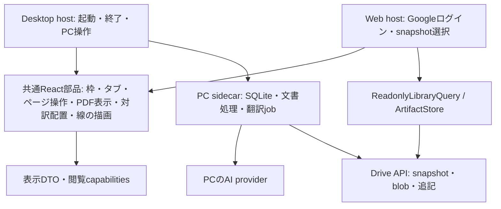

# PC / Web共通UIとsidecarの責務

更新日: 2026-10-18。Astraによる設計・実装・レビューに基づく。Web版はPCで翻訳した文書の閲覧とPDF追記に限定し、Web翻訳・AI質問・AI接続設定は提供しない。

## 採用した構成

画面、ライブラリの読み取り、成果物の取得、注釈の同期、PCの翻訳実行を分ける。別サーバーやマイクロサービスは追加せず、同じアプリ内のmodule境界として実装する。



`AppShell`をそのままWebへimportして機能を無効化する方式は採らない。Desktop hostにはTauri終了、保存待機、job監視、ファイル操作と設定画面を残す。Web hostにはGoogleログインと公表済みsnapshotの寿命管理を置く。

## 共通化したもの

| 部品・契約 | 利用箇所・責務 |
| --- | --- |
| `components/WorkspaceChrome.tsx` | PC/Web共通の画面枠、サイドバー枠、ヘッダー、タブ枠 |
| `index.css` | PC/Web共通のフォント、色、明暗テーマ、基本タイポグラフィ |
| `features/reader/PageNavigatorView.tsx` | 同じページ入力・前後移動部品。commandとショートカットの案内はhostが指定 |
| `features/reader/PdfDocument.tsx` | legacy pdf.js worker、CMap、フォント、読み込み失敗の扱いを統一。認証headerはPC hostだけが渡す |
| `features/reader/ReaderSplit.tsx` | 原文/訳文の同じ左右分割レイアウトと幅変更 |
| `features/reader/InkDrawing.tsx` / `inkGeometry.ts` | 手書きの描画・座標・当たり判定。保存と編集可能範囲はhost別 |
| `runtime/libraryItems.ts` | 項目の表示名・種類・親・フォルダーを同じDTOへ変換。PC一覧の表示名とWebの一覧が利用 |
| `runtime/contracts.ts` | 通信hook、Tauri、DriveのIDやローカルパスに依存しない閲覧契約 |

PCの整理・翻訳・付箋編集等と、Webで提供する操作には違いがある。サイドバーの整理操作やPDFの全編集機能まで同じものとして公開しない。共有する見た目・表示部品と、hostの利用可能な操作を分ける。

## 閲覧・成果物の契約

`LibraryItemView`は項目ID、表示名、種類、親ID、フォルダー名を保持する。`ArtifactView`はopaqueな資料ID、所有項目、表示名、ファイル名、media type、原文/訳文/添付等の役割を保持する。

`ReadonlyLibraryQuery`は一覧・資料一覧・保存済み付箋/チャット・対訳ページ対応を返す。`ArtifactStore`は資料IDからBlobを返し、埋め込み画像の相対参照を同じ項目内だけで解決する。UIはGoogle file IDやローカルファイルパスを組み立てない。取得したBlobから作るobject URLは表示側が解放する。

Webの`createDriveLibraryRuntime`は既存の`DriveSession`をtransportとして使用する。認証・Drive API全体をsidecar互換APIへ作り替えず、必要な閲覧機能だけをadapterにする。PCの既存HTTP query/jobは維持し、使わない汎用Desktop runtimeは作らない。

項目の資料一覧では正規の原文・訳文を優先し、review-backups内の再翻訳前の保存履歴を除外する。同名PDFでも保存履歴や添付は正規文書のrole・注釈対象を持たない。「ライブラリ全体のファイル」では保存履歴を相対パスで区別して残す。

runtimeはlogin epoch、library ID、snapshot revisionを持つ。資料IDはruntimeごとに異なり、別runtimeへ持ち越せない。切替・ログアウト時はdisposeで読込を中止し、transportや本文解析が遅れても古い応答を返さない。query keyにもこのscopeを含める。

## 対訳ページ対応

PCはsnapshotへ`web-reading.json` version 1を追加する。`reading_state`と同じ情報から、原文ページ番号ごとの訳文artifactと、そのPDF内のページ番号を公表する。これにより、途中まで翻訳した単ページPDFも正しい原文と対応する。

```json
{
  "version": 1,
  "items": {
    "<item-id>": {
      "pageCount": 3,
      "translatedPages": {
        "1": null,
        "2": {"artifactPath": "papers/<item-id>/translation-pages/<run>/page-2.pdf", "page": 1},
        "3": null
      }
    }
  }
}
```

raw pathはDrive adapter内でopaqueなartifact IDへ変換する。欠けた資料・別項目への参照を訳文として使わない。訳文がないページは未保存と表示し、同番号の別PDFを推測で表示しない。

古いsnapshotに対応情報がなければ、従来どおり資料を1つずつ表示する。更新したPCアプリは`web_reading_version`を公表済みstateに保持し、ライブラリに変更がなくても旧snapshotを一度更新する。形状不正の旧翻訳metadataはその文書の対応情報だけを省略し、元ファイルや正常文書の転送を妨げない。

## Webで提供する操作

| 操作 | Web |
| --- | --- |
| 原文・保存済み訳文・手書きノート | 閲覧 |
| 原文と日本語訳 | 対応情報がある文書で左右表示・同時ページ移動 |
| 保存済みサマリー・メモ・付箋・チャット | 閲覧 |
| 正規原文/訳文PDFへのペン・蛍光ペン・文字 | 追記、Web追記の消去・undo/redo、Drive保存 |
| 翻訳・AIへの新規質問 | 提供しない |
| Codex・AI provider・端末設定 | 読込・表示しない |
| PCの既存メモ/付箋編集・整理・削除 | 提供しない |

`runtime/capabilities.ts`は閲覧と生成を別々に持ち、Webのtranslation.generate、chat.generate、provider.configureは恒常falseとする。AI認証を閲覧の条件にしない。注釈対象はsource hashを持つ正規PDFに限定する。

## sidecarに残す責務

- SQLiteとローカル文書の正式な編集、バックアップ、復元。
- 既存Python coreのPDF抽出、OCR、数式・段組・フォント、翻訳検証、PDF組版。
- PCの翻訳計画、jobの排他・進捗・取消・再開、providerの起動と推論。
- WindowsのOAuth資格情報保護、Google token更新、snapshot公表とWeb追記の取り込み。

既存のPython provider registryは維持する。将来PCのAI認証・API providerを追加する際も、共通UIやDrive側を変更する前提にはしない。PDF表示がブラウザーで動くことを根拠に、PythonのPDF生成engineをWebへ移植しない。

## 注釈と保存の整合性

既存annotation-v1の不変操作、source PDF hash、UUID、取り込み済みledgerを維持する。WebはPCのsnapshotやPDFを上書きせず、追記だけを別ファイルで送る。通信失敗時はブラウザー内の下書きから再送し、PCは次のアップロードで検証して取り込む。

Web翻訳を提供しないため、複数executorによる翻訳結果の採用・merge・分散jobといった未使用の仕組みは実装しない。現在のPC単一snapshot writerを保つ。

## 検証の境界

- 共通DTO・capabilitiesとDrive adapter: schema、資料の整合性、相対参照、旧snapshot、取消、dispose、遅延応答、login/library/revision分離。
- Python snapshot: 途中訳の正確なページ対応、旧snapshotの自動更新、不正metadataでも正常文書を公表できること。
- Web E2E: 原文/日本語訳の表示、保存済み資料・履歴、sandbox HTML、左右対訳、注釈保存・通信失敗・再読込・複数端末・PC取り込み。
- PC: 共通部品への変更がページ操作・左右表示・既存翻訳を損なわないこと。Python翻訳engineは変更しない。
- Web build: sidecar/Tauri・AI接続設定・秘密資格情報を含めない。Pagesのサブパスでworker・CMap・フォントを読み込めること。

iPad幅・Pointer Eventsのブラウザー試験と、iPad実機Safari/Apple Pencil試験は区別する。実機で行っていない確認を完了扱いにしない。
