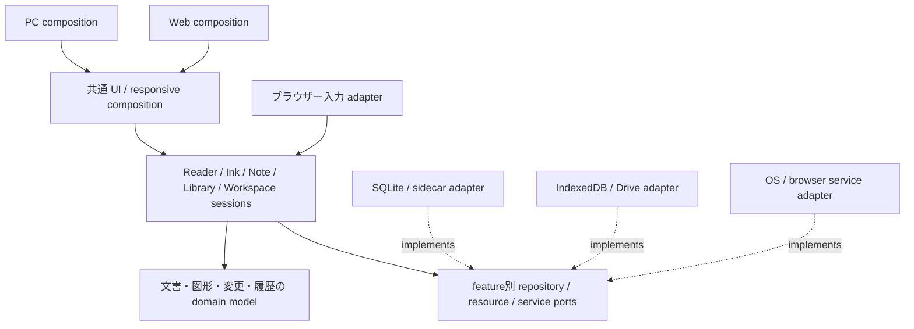

# PC・Web共通アプリケーション設計書

更新日: 2026-10-24

状態: **目標設計。統合実装の完了を示す文書ではない。**

現在の実装範囲・未接続箇所・試験結果は[実装記録](shared-app-implementation.md)を参照する。

実装順序・検証・進捗は[計画書](shared-app-plan.md)、Solによる指摘と対応は[初回5名](shared-app-review.md)・[第2回3名](shared-app-review-2.md)・[第3回3名](shared-app-review-3.md)・[最終5名](shared-app-review-4.md)のレビューを参照する。[runtime-architecture.md](runtime-architecture.md)は既存の部分共通化の記録であり、本書とは現状／目標の関係にある。設計判断が異なる場合、今後の統合は本書を基準とする。

## 1. 要求と設計方針

### 1.1 ユーザーから確定している要求

- PC・Webで同じ通常の閲覧・編集操作を提供し、同じ処理を別々に実装しない。
- 共通化の単位は、UI部品やhookではなく、ユーザーが操作を完遂できる機能とする。
- PDF左右表示の書き込みツールバーは文書に1本とし、操作対象を切り替える。
- 指スワイプで前後ページへ移動でき、前後ボタン・矢印キー・スワイプ後はページ先頭へ移動する。
- PDFの縮小は、その表示領域でページ全体が収まる大きさで止める。
- 図形を含む書き込み機能を両版で提供する。
- 旧版との互換性は設計制約としない。理想の共通構造へ置き換える。
- 共通化に必要な構造変更は行うが、全機能用の巨大storeや汎用同期基盤は作らない。

### 1.2 本書で採用する設計判断

| ID | 決定 |
| --- | --- |
| D01 | 共通UI、featureごとのsession、domain model、repository契約、環境別adapterを分離する |
| D02 | PC/Web別の簡易editorを維持せず、同じReader・注釈editorを両方で使う |
| D03 | 通常編集を作成元やID接頭辞で制限しない。編集可否は実際の権限・文書状態で判断する |
| D04 | PDFと手書き用紙を「ページ背景の違い」とし、同じsurface・注釈編集を使う |
| D05 | 図形は種類ごとの意味を持つモデルにする。すべての図形を保存時点で点列へ潰さない |
| D06 | 確定した1編集操作を1変更batch・1履歴単位として扱う。ページ構成と内容を同時に変える操作も両保存先で原子的に耐久化する。本文入力のグループ化はNoteSessionの規則に従う |
| D07 | 編集開始時のbase version、受信済みremote version、未保存のlocal変更を分離する |
| D08 | 共通schemaから型・検証器を生成し、複雑な整合性規則も同じ適合fixtureで検証する |
| D09 | 既存の純粋な計算・共有部品は再利用する。旧形式への分岐・二重書き込み・旧client判定は設けない |
| D10 | 既存データを自動的に破棄しない。必要なデータ変換はバックアップ付きの一回の変換とする |

AI生成・OCR処理・provider設定、OSのファイル選択・アプリ終了などは、提供されるserviceに応じた接続を持つ。PDF内検索、図形、引用移動、capture等を「Webだから非対応」とは扱わない。

## 2. 現状と問題

### 2.1 再利用する共有実装

`ReaderCommand`とキー／wheel判定、倍率と座標の純粋計算、`usePairedReaderScroll`、`WritingToolbar`の配置・対象登録、`MarkdownContent`、`treeKeys`、`ReaderDock`、`ReaderSplit`、`NoteEditSession`の失敗時保持、autosaveの基本処理は再利用候補とする。

ただし、「共有ファイルにある」「型が同じ」「同じボタンを描く」は、featureの共通化が完了した根拠にはしない。

### 2.2 調査で確認した未共通化

2026-10-24に3 subagentsで別領域を調査した。以下の参照は調査時点の実装であり、移行時に更新する。

| ID | 問題 | 主な根拠 |
| --- | --- | --- |
| A01 | Readerの状態更新、着地、履歴がPC storeとWeb local stateで別 | [navigation](../frontend/src/features/reader/navigation.ts)、[DocumentReader](../frontend/src/web/DocumentReader.tsx)、[ReaderCommand](../frontend/src/features/reader/readerCommands.ts) |
| A02 | Pointer系とTouch/Safari系でowner・anchor・preview・cancelの意味が別。Web editorにもpanが残る | [Pointer入力](../frontend/src/features/reader/usePdfPointerInput.ts)、[Touch入力](../frontend/src/features/reader/usePdfSurfaceInput.ts)、[Web PDF](../frontend/src/web/PdfReader.tsx) |
| A03 | PDF計測・描画・readiness・復元が二重 | [PdfPane](../frontend/src/features/reader/PdfPane.tsx)、[PdfReader](../frontend/src/web/PdfReader.tsx)、[usePdfReadingPlace](../frontend/src/web/usePdfReadingPlace.ts) |
| A04 | PC注釈、Web PDF、手書きノートの3 editor。図形・選択・変形等がWeb PDFに不足 | [useInkEditor](../frontend/src/features/reader/useInkEditor.ts)、[InkOverlay](../frontend/src/features/reader/InkOverlay.tsx)、[PdfWritingTools](../frontend/src/web/PdfWritingTools.tsx)、[HandwrittenNote](../frontend/src/features/notes/HandwrittenNote.tsx) |
| A05 | 同じノートのsessionを共有しても履歴がview単位。二重mount時に他viewの編集をUndoで消し得る | [WebLibrary](../frontend/src/web/WebLibrary.tsx)、[HandwrittenNote](../frontend/src/features/notes/HandwrittenNote.tsx)、[NoteEditSession](../frontend/src/features/notes/noteEditSession.ts) |
| A06 | Web Markdownのdirty本文が新remote revisionをbaseに使い、競合を見逃す経路 | [WebNotes](../frontend/src/web/WebNotes.tsx)、[MarkdownNote](../frontend/src/features/notes/MarkdownNote.tsx) |
| A07 | Web eraserがstrokeごとの保存・Undo。途中失敗で部分適用され、一操作の再試行ができない | [PdfReader](../frontend/src/web/PdfReader.tsx)、[annotations](../frontend/src/web/annotations.ts)、[InkPage](../frontend/src/features/reader/inkStore.ts) |
| A08 | PCのPDF全置換保存とWeb単strokeログで、版・競合・受理・復元の意味が異なる | [inkStore](../frontend/src/features/reader/inkStore.ts)、[ink API](../sidecar/routes/ink.py)、[cloud annotations](../papeer/core/cloud_annotations.py) |
| A09 | TS/Pythonの検証と競合タイトル生成が不一致 | [noteDocuments](../frontend/src/runtime/noteDocuments.ts)、[cloud notes](../papeer/core/cloud_notes.py)、[ink model](../papeer/core/ink_model.py) |
| A10 | noteと添付でID状態とfallbackが競合し、選んだ添付の代わりにnoteを表示する経路 | [WebLibrary](../frontend/src/web/WebLibrary.tsx) |
| A11 | tree投影、選択・reveal、workspace遷移、作成・配置規則、preferencesが別 | [PC library](../frontend/src/features/library/LibrarySidebar.tsx)、[Web sidebar](../frontend/src/web/WebLibrarySidebar.tsx)、[Web tree](../frontend/src/web/librarySidebarTree.ts)、[NotesPane](../frontend/src/features/notes/NotesPane.tsx) |
| A12 | Markdown構文は共有したが、引用・資料移動・画像の寿命・lightboxの接続が別 | [MarkdownRenderer](../frontend/src/components/ui/MarkdownRenderer.tsx)、[WebLibrary](../frontend/src/web/WebLibrary.tsx)、[WebNotes](../frontend/src/web/WebNotes.tsx) |
| A13 | 固定ファイルの直接import検査では、推移依存・片側だけの利用・機能欠落を検出できない | [boundary test](../frontend/tests/readerBoundary.test.mjs)、[Web build境界](../frontend/vite.web.config.ts) |

A09の長い競合タイトルと退化した文字枠の受理差は、既存関数の直接実行で確認した。他の不具合・リスクは静的な実行経路の確認であり、今回の調査でUI再現試験は行っていない。計画書の回帰試験で再現・検証する。

## 3. レイヤーと依存方向



矢印は主な参照・入力関係を示す。compositionがadapterを生成してportとして注入し、共通featureが具象adapterをimportしない。

| 層 | 所有する責務 | 所有しない責務 |
| --- | --- | --- |
| 共通UI | 表示、focus、アクセシビリティ、toolbar、幅に応じたoverflow | 保存、host判定による機能一覧、独立した履歴 |
| feature session | command適用、selection、draft、履歴、遷移guard、購読可能なsnapshot | Tauri、Drive、HTTP URL、storage key組み立て |
| domain | identity、座標、geometry、変更、整合性規則、状態遷移 | DOM、React、ネットワーク、window |
| ports | 必要な取得・保存・通知・出力の契約と結果 | 全サービスを集めた万能runtime |
| adapters | DOMイベント正規化、取得、耐久化、認証、送信、OS操作 | toolの欠落、Undo単位、競合時の暗黙上書き |

feature sessionは通常のTypeScriptオブジェクトとして実装し、Reactからsubscribeする。既存Zustand storeはhost起動・job等に残せるが、共通featureの別コピーを持たない。sessionからUIへのstatus通知もsnapshotを通し、desktopのstatus storeへ直接書かない。

提案する配置は `frontend/src/features/{reader,ink,notes,library,workspace}` に共通feature、`frontend/src/runtime` に契約とschema由来型、`frontend/src/adapters/{desktop,web,browser}` に具象接続を置く。ディレクトリ移動だけで完了にしない。

**Reader responsibility map (current placement guide):** `reader/edit` owns document edit sessions, conflict presentation and history; `reader/ink` owns canonical ink operations, editor and preferences; `reader/input` normalizes reader gestures and selection. `reader/pdf` contains canonical PDF selection, search and outline helpers; `reader/annotations` and `reader/sticky` contain their respective annotation UI and operations. `reader/navigation` owns content navigation, history and reading-place sessions; `reader/reference` owns reference placement and restoration decisions. `reader/translation` holds translation dialog, review, jobs, start and PDF import; `reader/glossary` holds glossary editing, transfer and review; `reader/output` owns output controls and snapshot orchestration. Recovery currently follows its owning session or conflict component, not a separate `reader/recovery` directory. Existing Reader-root files remain where they are until a scoped move is verified.

Place a new shared behavior with its owning feature/session in these responsibility directories; keep schemas and cross-feature contracts in `runtime`, and concrete browser, web or desktop host integration in `adapters`. Do not add a second writer or journal merely to fit a directory. The completed translation C5 moved four Reader files and one unit test, with dependent imports updated; see [its checkpoint](../checkpoints/shared-app/2026-10-30-p4-workspace/reader-translation-organization-r1/README.md). This is a placement guide, not a second TODO list.


## 4. 共通モデルとidentity

### 4.1 文書・ページ・表示対象

```ts
type PageId = string;       // UUID。ページ番号とは別
type VersionId = string;    // checkpointまたは受理batchのID
type PageBackground =
  | { kind: "pdf"; resourceId: string; sourceRevision: string; pdfPage: number }
  | { kind: "paper"; spec: PaperSpec };
type Page = {
  id: PageId;
  backgroundRevision: VersionId; // PDF参照またはpaper specの版
  lifecycleVersion: VersionId;  // 存在・削除・復元の版
  widthPt: number;
  heightPt: number;
  background: PageBackground;
  annotationVersion: VersionId; // 文書snapshot内の部分版。独立したDAG headではない
};
type ContentTarget =
  | { kind: "reader"; documentId: string }
  | { kind: "note"; noteId: string }
  | { kind: "artifact"; itemId: string; artifactId: string };
```

これは目標契約の要点であり、既存の型を実装済みと示すものではない。

- library、document、page、artifact、annotation objectのID空間を型で区別する。共有DTOをUIの実際の入力にする。
- PDF内部のページ番号、読書上の論理ページ番号、注釈対象page IDを別に持つ。原文・訳文対応は明示的なmappingで解決する。
- PDF差し替えは`sourceRevision`変更で識別する。古い版の注釈を新PDFへ自動で重ねない。移し替えは独立した明示操作とする。
- Blob URL、Drive file ID、ローカルパスをsessionや履歴のidentityにしない。
- ページの追加・並替・削除は安定page IDを使うdocument command。削除後もUndoと未保存変更に必要な内容は保持する。
- 原文と訳文は別page/surfaceであり、同じ論理番号だから同じ注釈対象とは扱わない。訳文欠落はplaceholderとして表現する。
- 原訳mapping自体にも版を持たせ、原文の安定page IDから訳文のresource版・物理pageへ解決する。逆引きも同じmappingを使い、未翻訳・削除・複数候補・旧版不在は未解決として返す。表示番号で別の訳文へ代用しない。

保存上は`DocumentSnapshot.pages`を原文／ノートの論理順、`translation.pages`を別の訳文編集対象とする。双方に最大500pageを持たせ、訳文の追加によって原文の上限を250pageへ縮めない。訳文を持たない文書は`translation`を持たない。mappingは`translation.revision`と、原文・訳文それぞれのpage ID／backgroundRevisionを保持する。欠落は対応なし、複数候補は未解決のままとし、一つの訳文へ複数原文を黙って集約しない。

訳文一式の差替えは専用のDocument変更で原子的に扱い、旧訳文pageをannotationごと`deletedPages`へ退避する。同じIDで別の背景や古いannotationへ上書きしない。個別pageの編集は原文・訳文とも同じPageEditBatchへ接続する。背景Undo等ではpage変更とmapping参照の更新を同じDocumentEditBatchへ含め、現在の背景版に結び直す。意図的に未解決だった古い対応を自動解決することはしない。

### 4.2 図形・付箋・本文highlight

```ts
type InkObject = {
  id: string;
  geometry: Path | Line | Arrow | Rect | Ellipse | TextBox;
  style: InkStyle;
  transform: { x: number; y: number; rotationRad: number; scaleX: number; scaleY: number };
};
type PageAnnotation = InkObject | StickyNote | TextHighlight;
```

各geometryは`kind`で判別するunionとし、自由線は点列、直線・矢印は端点、矢印は矢尻設定、四角・楕円は寸法、文字は本文と枠・文字設定を保持する。pen/highlighterはpathのstyleで区別する。任意shear・永続groupは初期範囲に入れず、複数選択と永続groupを混同しない。

矢印は実際に表示する矢頭の長さ`headLengthPt`と、短い軸・ページ端で制約される前の編集上の希望値`preferredHeadLengthPt`を区別する。希望値は任意で、保存する場合は実長以上とする。矢頭は軸から±0.5radの二辺、両端指定でも同じ実長を使う。ページ端で矢頭が潰れた既存矢印を保全するため実長0を許可し、軸の長さ0は拒否する。変形・保存検証・用紙resizeの範囲計算は矢頭も含める。楕円は回転した空の外接矩形ではなく、変換後の曲線の極値を使う。

付箋は安定ID、本文、引用、ページ上のanchor、style、分類labelと作成日時を持つ。色の`null`は明示色の未指定であり、分類/defaultの色を共通presentationで解決する。本文highlightも引用とは別のコメント本文・分類・作成日時・移動先anchorを保持し、背景版に結び付くquadとtext rangeを持つ。作成日時はUTCのGregorian暦（年0001〜9999、秒の小数は最大6桁）で保持し、未知の場合は`null`とする。存在しない日付や端末timezoneへの暗黙依存を認めない。

text rangeは`{kind:'indexed',start,end}`または`{kind:'unindexed'}`の明示unionとする。indexedは共通text indexの位置であり、DOM Rangeやhost固有の検索結果を保存しない。旧記録や索引をまだ取得していない範囲には位置を捏造せず、unindexedのまま引用・quad・anchorで描画/移動/保存できるようにする。unindexedへ仮のstart/endを併記しない。索引の有無によって注釈そのものを削除・別pageへ付け替えない。自由線の蛍光ペンとは別のannotation型とし、同じPageEditSession、履歴、保存・競合経路へ接続する。

ページ座標はpoint（1/72 inch）単位で、PDFの有効CropBoxにUserUnitと固有Rotateを適用した表示領域の左上を原点、右をX正、下をY正とする。widthPt/heightPtもこの領域の寸法である。用紙のmmは境界で変換する。共通geometryが「PDF元座標 ↔ このページ座標 ↔ object変換 ↔ CSS client座標」を担当し、exportも同じ逆変換を使う。追加の表示回転はview変換だけに持たせ、DPRはrasterの解像度だけに使う。CropBoxの非ゼロoffset、90/180/270度、UserUnit、DPRを適合fixtureに含める。

拡縮は正値のみとし、矩形等の変形はgeometryの再設定、全体拡縮はtransformとして扱う。全体拡縮では線幅も拡縮し、端点handleによる形状変更では線幅を維持する。保存座標は表示倍率、DPR、左右幅に依存しない。

楕円・矢印等の点列化は描画、hit判定、exportの境界で行う。既存のsnap・hit判定・消去・矢尻の計算と挙動を再利用し、保存モデルに合わせて入出力を変更する。

### 4.3 schemaと検証

新しい共通schemaを生成元とし、TypeScript/Pythonの型・構造検証器を生成する。OpenAPIの通信型もここに対応させる。geometryの非退化、変換後の寸法、版・所有関係等の規則は同じ適合fixtureを両言語で通す。schema生成だけで業務規則まで自動共有できるとは扱わない。

初期上限はページ500、ページ内object 3,000、1path 20,000点、ページ内path合計200,000点、文字本文2,000文字、タイトル200文字を基準とする。文字数はUnicode code point数で数え、TSのUTF-16 lengthとPythonのlenの差を残さない。生成する競合タイトルはsuffix分を差し引いて切り詰め、必ず通常の検証を通す。上限・suffixは共通定数にする。

## 5. sessionと寿命

| 状態 | 所有者・寿命 |
| --- | --- |
| theme、tool設定、色、太さ、favorite、幅等 | profile preferences。再起動後も保持 |
| アプリ内clipboard | account session。文書・ページ・原訳を越えて利用 |
| navigation、倍率、表示mode、active surface、ページfilter | ReaderSession |
| object selection、annotation draft | pageのPageEditSession。InkSessionはその描画操作を担当 |
| ink・付箋・本文highlight・ページ構成の編集history | 文書のDocumentEditHistory。page別表示は投影であり別stackではない |
| pointer所有権、preview、文字配置中の状態 | editor session。DOM instanceごとに別historyを作らない |
| dirty本文、編集開始base、remote本文 | NoteSession |
| 付箋/本文highlight一覧のscope・検索・分類・並び順・scroll | AnnotationBrowserSession。編集内容はPageEditSessionの同じread modelを見る |
| Library検索・tag/読書状態filter・並び順 | LibrarySession。query generationごとに結果を照合 |
| pending変更、outbox、失敗内容、受理記録 | repository scope。UIのmountより長い |
| タブ・パネル・表示対象・focus | WorkspaceSession |

同じ内容のviewは複数存在できるが、**編集するsurfaceの所有者は対象ごとに一つ**とする。「右パネルから中央へ」は新しい独立editorの追加ではなくplacement変更。参照viewには編集commandや描画所有権を与えない。描画ownerはtokenで登録・解除し、一方のunmountが別の操作中状態を解除できないようにする。

遷移はWorkspaceSessionから同じguardを通す。古い取得応答・render callback・保存応答はscopeとgenerationを照合して反映しない。

| 遷移・状態 | 規則 |
| --- | --- |
| 同じ対象のpanel/中央移動・resize | sessionを維持。gesture中はplacement変更を保留し、二重editorを作らない |
| page移動・履歴・引用jump | 描画gesture中は拒否。文字draftは確定/取消を求める。対象sessionに未耐久変更があれば保存再試行/明示破棄まで保留し、navigation/historyを先に更新しない。保存実行中/結果不明は第8.2節で確定するまで保留 |
| 原訳mapping/PDF版更新による表示対象の差替え | 原文の現在pageが同じでも、surfaceのpage ID・背景版・resource版が変われば編集対象遷移。旧gestureを取消し、文字draft・未耐久/結果不明を旧対象のまま解消してからmapping・active target・表示bindingを一括更新 |
| document/library切替時に未耐久変更あり | 遷移を保留。再試行で耐久化するか、内容を示した明示的な破棄で解消する。自動破棄しない |
| 同account内切替時に耐久済み・未送信あり | 遷移可。旧repositoryと送信queueをscope registryに保持する |
| logout/account切替 | 未耐久変更は上記と同じ。耐久済み・未送信は元accountの領域に残し、認証解除後の送信を停止。同accountへ戻った時に再開する |
| 再入場・再起動 | 耐久済みjournal/outboxを全page分列挙。前accountの変更を別accountへ送らない |

すべての耐久保存が失敗したメモリ上の変更は、process終了後の復元を保証できない。終了前の保存再試行・明示破棄・exportを案内し、native終了guardとbrowserのbeforeunloadを可能な範囲で接続する。browser終了通知の成功を保証とはしない。

保存要求の送信前に、account/library/epoch別のintent journalへ完全な要求を保存する。送信開始前の記録と、送信した可能性のある記録を区別し、後者の回復では同IDの受理確認／再送を行う。Undo要求は元の応答待ち中にも耐久化し、逆batchのIDと内容も送信前に固定する。これらのjournalは未送信outboxとは異なる端末内の回復情報であり、未適用のままDriveの採用済み変更として公開しない。

journalの更新・削除は期待revisionとのCASで行う。応答消失時は同じ更新IDとpayloadで確認し、別tab/instanceの要求を上書きしない。一度記録した送信可能性・Undo要求・逆batchを古い状態へ戻さない。元batchと必要な逆batchの受理、journal削除の確認まで遷移guardを維持する。起動・account再入場では未表示文書も含めて列挙し、未処理のfeature用intentを黙って破棄しない。

## 6. Reader・入力・surface

### 6.1 共通navigation

`ReaderSession`がページ・倍率・履歴・着地を更新する唯一の入口となる。toolbar、キー、wheel、swipe、目次、検索、引用、PDF内部linkは同じcommandへ接続する。

```ts
type ReadingLocation = {
  libraryId: string;
  documentId: string;
  pageId: PageId;
  backgroundRevision: VersionId;
  surface: "original" | "translated";
  anchor?: { xPt: number; yPt: number };
  textRange?: TextRange;
};
type Landing = "start" | "end" | "restore" | { anchor: ReadingLocation };
```

論理ページ番号は指定ページcommandの入力として使い、現在の文書・mapping版から安定page IDへ解決する。履歴・引用のidentityに番号だけを保存しない。古い背景版・削除pageが解決できない場合は明示して停止し、同じ番号の新pageへ黙って移動しない。

資料間の選択と戻る履歴は小さな`ContentNavigationSession`が所有し、文書内のページ・倍率・位置は`ReaderSession`が所有する。同scope内ではrepository／registry／replicationを維持する。現在controllerのprepareClose／canClose、catalogと対象rootの読取、await後の表示ID・登録guard・世代・active再確認を通して選択を更新する。移動先の編集sessionは検証前に作らない。

同scopeのopeningにscope全体のprepareLeave／suspendを使わない。未表示の復旧draftがあるだけで、そのノート自体を開けなくなるためである。移動先がdirty・pending・複数heads・壊れたscratchでも、復旧状態を見るためのopeningを許可する。scope／accountの退出では全sessionを検査し、beforeunloadも未表示sessionとdraft列挙を含む同期確認を使う。

canonical引用は`papeer://citation/<libraryId>/<documentId>/<pageId>?backgroundRevision=<uuid>&surface=original[&xPt=...&yPt=...]`を使う。query重複や余分な値、旧ページ番号URIは推測解釈しない。選択版の実page collectionと背景版・pt範囲を確認して共通Readerへ渡す。位置・履歴・landingの背景版は保存し、異版や版不明の座標を新背景へ当てない。表示面のready通知も期待surfaceKeyを渡し、旧背景の遅い完了を拒否する。明示bindingの両本番mountは原文・訳文・左右表示を同じReaderへ接続する。`surface=translated`のpageIdは訳文collectionの実UUIDで、一意な逆mappingを確認して原文の論理位置と表示面を同時に決める。未対応・多対一・複数候補は拒否し、物理番号から原文を推測しない。既定起動と旧経路の撤去は別の残工程とする。

Readerは原文論理pageId、activeSurface、display、activeの実surfacePageIdを分離する。位置は実pageIdと背景版ごとに保持する。左右表示の非操作面は自身の描画完了・寸法・位置復元を管理し、利用者の実スクロールだけに正規化位置で追従する。poll・倍率復元・layout remountを同期scrollと誤認しない。非操作面の最初のpointer操作は全指が離れるまで面の選択として消費し、次の操作から編集する。toolbar・文書編集session・Undo/Redoは一つとする。

| 入力 | 共通commandと着地 |
| --- | --- |
| 前後ボタン・左右矢印・swipe | step前後、`start` |
| PageDown・下端から次へ進むwheel | step次、`start` |
| PageUp・上端から前へ戻るwheel | step前、`end` |
| 指定ページ・目次 | jump、`start`（指定anchorがある場合はそれを優先） |
| 検索・引用・内部link・履歴 | 安定page/背景版と記録anchorへ移動 |
| remount・resize・再表示 | `restore` |

同じ意味のcommandはhost・入力方式によらず同じ結果とする。履歴は同じpageの別箇所を区別する。直接jump等は履歴に積み、通常のstepは積まない。command結果は適用・変化なし・拒否を区別し、拒否理由も返す。

`ReaderSession`は「全ページ／翻訳済みページのみ」と、版付き原訳mappingから得る移動対象集合を持つ。filterの適用可否は翻訳を持つ文書かで判断し、手書きノート等には適用しない。stepとHome/Endは対象集合内で移動する（Home/Endは先頭/最後の対象pageの`start`）。filterを有効化した時に現在pageが対象外ならguardを通して最初の対象へ移動する。対象が空なら現在の原文位置を保ち、訳文なしを表示してstep/Home/Endは変化なしとする。

指定ページ入力はfilterを解除する。引用・検索・目次・link・履歴は対象外へ明示jumpする場合にfilterを解除する。filter解除、navigation、履歴更新はguard通過後にまとめて適用する。翻訳状態更新では集合を再計算し、現在pageが残れば位置維持、外れた場合は同じguardで最初の対象へ移動する。拒否時に自動再実行せず、現在位置と変更された対象集合を表示して利用者の次の操作を待つ。

集合更新による原文位置維持と、各surfaceのbinding維持は別に判定する。原文Oの対応訳文AがBへ変わる場合も第5節の差替えguardを通す。更新通知の新mappingは候補として保持し、編集中の旧bindingを先に上書きしない。旧対象へ保存するdraftを新背景へ載せ替えず、guard解消後に新bindingのgenerationへ切り替える。旧render/保存callbackはbindingとgenerationを照合して拒否する。

移動guardは状態更新・履歴更新より前に評価する。描画中・文字編集中・未耐久変更のある遷移は、sessionの確定／保留／取消規則を通す。拒否したgestureを後から自動再実行しない。独立した`PdfReader.localPage/localZoom`やhost別の第二dispatchを残さない。

### 6.2 倍率とレイアウト

- 倍率型は`fit-page | scale`。scaleは幅fitを基準とする連続倍率、上限400%。固定の最小倍率ではなく各surfaceの実寸からページ全体の下限を求める。
- 非操作側は自身の描画下限だけ適用し、共有倍率を書き換えない。`fit-page`では各surfaceが自身のfitを計算する。
- pinchは実際の表示サイズから開始し、同じページ上の点を指の下に維持する。再描画完了後もanchorを維持する。
- レイアウト変更はviewportの利用可能寸法で決める。manual single/split選択を優先し、autoはヒステリシスを持つ共通policyにする。
- toolbarは同じspecから生成し、狭幅ではoverflowへ移す。入力機器やhostを画面幅から推定しない。
- 原訳左右表示でもtoolbarは1本。active targetを変更してもtool設定・page selection・文書編集履歴は失わない。

### 6.3 入力と描画

browser adapterはPointer/Touch/Safari等を正規化する。Pointer Eventsを基本に、GestureEvent等の補完streamも同じgesture sessionへ送る。イベントstreamの所有者を一つにし、同じpinchを二度処理しない。pointer capture、passive listener、preventDefault等のDOM機構はadapter責務、pan/pinch/swipe/draw/本文選択の判定と状態遷移は共通責務とする。

本文選択と選択handle操作も入力ownerに含める。描画/消去等がactiveな間は本文選択を開始しない。閲覧中のtouch長押し候補は共通の時間・移動閾値でpan/swipeとの所有権を裁定し、選択開始時はpan/swipe候補を取り消す。選択handle操作中は移動量によらずpage移動へ転用しない。adapterはnative選択開始/変更/handle操作を通知し、選択を妨げるcapture/preventDefaultを発行しない。nativeで安定して調停できない入力経路は共通text layerの選択controllerを使い、host別の選択機能は作らない。

本文選択中の二指操作は現在のrangeを固定してpinchへ渡し、全離指まで選択延長・swipeへ戻さない。選択解除した同じgestureもswipeへ再利用しない。文字編集中はfieldの選択/キー所有権を優先する。

指で描く設定が有効ならtouchをinkへ渡す。touchの描画・消去・変形preview中に二指目が参加した場合、未確定previewを取り消してpinchへ渡す。batchと履歴は追加しない。pen接触中はpalmを無視し、pinch/page移動へ引き渡さない。二指から一指へ戻った場合はpanだけを許可し、全指が離れるまでink/swipe候補へ戻さない。cancel、lost capture、blur、scope変更では未確定previewを取り消し、ページ移動を起こさない。既に確定した編集は取り消さない。

swipeは開始時に対応する横端にあること、横移動72 CSS px以上、最大縦移動の1.5倍以上を条件とし、離指時に1ページだけ移動する。横端へ到達した同じpanをページ送りへ変換しない。wheelの慣性抑止、IME・入力欄・toolbar・非表示viewのキー所有権は既存の共通判定を維持する。

共通`PdfSurface`は計測、page geometry、layout幅とrender幅、canvas budget、preview、描画完了待ち、遅延callback拒否、text/annotation layers、resize復元を所有する。resource adapterはBlob/認証付きURL等を供給するだけにする。PDF以外のpaper背景も同じ編集surfaceへ載せる。

## 7. 注釈editorと履歴

`InkToolSpec`にtool、label、option、shortcut、適用可能な対象、toolbar groupを一箇所で定義する。feature仕様一覧は[計画書の受入表](shared-app-plan.md#4-機能別の受入表)を正とし、hostの現在のtool一覧からテスト対象を減らさない。

対象はpen/highlighter、全図形、文字、矩形・投げ縄選択、複数選択の移動・拡縮・回転、図形handle、snap、色・太さ変更、copy/cut/paste/duplicate、全体・部分消去、蛍光ペン限定消去、Undo/Redo、表示・lock・一覧、共通設定である。

`PageEditSession`がannotationのselectionと変更生成を持ち、`InkSession`が描画previewを担当する。ink・付箋・本文highlight・ページ構成の確定操作は、文書に一つの`DocumentEditHistory`へ適用順に記録する。初期上限は文書あたり50操作。UI、page view、保存adapterに別のUndo stackを作らず、pane remountやplacement変更でも失わない。回復情報をjournalと一緒に保持する。

履歴entryは操作ID・実行batch版への参照を保持し、文書の全snapshotをUndo stackへ複製しない。Undo/Redoは現在版へ適用する逆batchであり、対応する元操作IDと`undo`／`redo`をHistoryRecordへ保存して再起動後にもstackを復元する。注釈の復元では重なり順を明示する。背景を戻す場合は本文highlightの背景参照も同じ操作内で戻す。参照元の不変版が失われた場合や内容が分岐している場合は、古いsnapshotで上書きせず拒否・比較へ送る。

toolbar/shortcutのUndoはactive文書の最新編集を対象とし、必要なら影響pageへ移動する。例えば「Aに描画→Bへ複製→Bに描画」は逆順でUndo/Redoする。navigationは編集履歴へ積まない。文字入力focus中は該当text sessionの入力Undoを優先し、注釈本文の確定を文書の1編集とする。MarkdownはNoteSessionが入力groupとCodeMirror履歴を持ち、viewのremountで失わない。

copyはclipboardへの非永続操作、cutは元pageへの1batch、pasteは先pageへの新object作成batch。ページを越えたcut/pasteを分散transactionとはしない。paste先に収まる座標変換を共通処理で行う。由来を問わず実権限があれば既存objectを編集でき、別文書へ貼り付ける場合は新IDを作る。

## 8. 保存・同期・競合

### 8.1 共通保存契約

```ts
type PageEditBatch = {
  id: string;
  libraryId: string;
  documentId: string;
  pageId: PageId;
  backgroundRevision: VersionId;
  lifecycleVersion: VersionId;
  baseVersion: VersionId; // Page/Document共通の文書version
  changes: (CreateAnnotation | UpdateAnnotation | DeleteAnnotation)[];
};
```

updateでobject IDを維持する。`web-*`という作成元IDによる権限制限や、updateを別IDへのremove/addへ変換することを共通modelの前提にしない。

Page repositoryは、取得・購読・batchの耐久化・flush・復元・同期結果を提供する。paperもPDFも`backgroundRevision`で座標の前提を検証する。Document構造変更、Markdown本文、Library整理はそれぞれのfeature用batchとportを持ち、annotationのchangesへ押し込まない。全アプリの万能command/event storeは作らない。

| 契約 | 原子的な編集範囲・検証 |
| --- | --- |
| PageEditBatch | 同pageの全annotation。親文書versionと、そのsnapshot内のannotation版・背景版・lifecycle版を検証 |
| DocumentEditBatch | page構成と関係する背景・annotation初期内容・削除記録。PageEditBatchと同じ親文書versionと影響pageの部分版を検証 |
| MarkdownEditBatch | 本文と編集開始base。入力group、保存generation、remote版を分離 |
| LibraryEditBatch | 名前、tag、既読、folder、関連付け、配置、論理削除集合等。library全体の親metadata版に対して所有・循環・参照整合性を検証 |

DocumentRepositoryがページ構成と内容のatomic commitを調停する。read/command facadeを分けても、構成保存→ink保存の別transactionにはしない。作成・複製は必要な初期内容をbatch内または参照先の不変snapshotで確定し、削除はtombstoneとUndo用内容を残す。実行前に影響pageの未耐久編集を耐久化し、失敗時は構成操作を拒否する。耐久済み未送信の内容も複製snapshotに含める。削除pageへの遅延編集は競合として保持し、勝手に復活させたり捨てたりしない。

新規note/importは、metadataと初期文書を一体で公開する専用commandを用意する。resourceをhash付きで先に耐久化し、参照可能になるまで項目を公開しない。失敗した未参照resourceの自動削除は初期範囲に入れない。これらは対象を限定した保存契約であり、汎用transaction frameworkへ広げない。

| adapter | 同じ意味で実行する処理 |
| --- | --- |
| SQLite/API | 対象version・全changeを検証し、projection・履歴回復情報・受理記録・完全なbatch payload・送信義務を表すoutboxを同じDB transactionで保存 |
| IndexedDB/Drive | 同じ情報をIndexedDB transactionでまとめて保存し、immutable batchを1 Drive objectとして送信 |

Driveの転送単位を単strokeへ分解しない。PCもcheckpointだけでなく送信可能なbatchを残し、commit直後のprocess停止でも再送できるようにする。PC importerもbatch全体の検証後に一括適用する。snapshotはcheckpointであり、編集batchの代替にしない。Driveへのupload受理と他端末の取込確認は別のreceiptとして持つ。背景版、対象権限、変更前version、データ上限をadapter側でも検証する。

**採用方針・統合検証中:** Webで最初の新規provider-linked Libraryを扱う際、既存local canonical IndexedDBに通常操作からversionchangeを送らず、host管理の固定名cloud cacheを別に用意する。cacheでも既存canonical schema・owner authority・journal／repository実装を再利用し、同じtargetに複数writerを置かない。新cache参加者のlockとscope gateは失効・drainを含めて検証し、旧tabが参加しないlockだけで旧localの停止を証明しない。Nativeは同じ安全契約を満たす既存SQLite ownerを使い、物理DB分離は必須としない。両hostの実装をrootへ統合し検証中であり、実Google接続・既存local Libraryの連結は未確認である。

hostは実認証principal、local lease、descriptor bytes／hash／version、owner・write、Library／epochとactive bindingを照合してopaque admissionを発行する。保存row、偽profile、remote JSONやlockだけで権限を作らない。別account・旧世代・revoked binding・scope違い・遅延callbackを拒否する。新規create／joinは不変planとresource・checkpoint・manifestの検証後、cache側の一つのowner transactionでprofile／control／peer／bindingと対象dataをactivationし、unknownは同一requestで照会／回復する。cold／offlineのunlock、欠落・破損、quota、streaming、backupも明示する。

既存local Libraryのlink／copyは別段階とする。別DBを跨ぐ単一transactionはないため、元scope／Library／epochと来歴を保ち、durable prepare／publication／activation／ack・再照会・rollbackでsourceを保持する。前段の同一transaction要件は各DB内部へ適用し、跨DB全体を原子的と偽らない。Nativeは物理DBを分けること自体を必須とせず、同じowner・単一writer・原子性・失効・回復契約を満たす方式を選ぶ。

送受信の順序・再試行・受理の意味は共通TypeScriptの`EditReplication`、Drive上の編集/resource/checkpoint envelopeは共通adapterが所有する。通常編集・作成はどちらも`EditRecord = { batch, history?, publication? }`を`edit-record` envelopeへ格納する。Undo/Redoのactionをcheckpointだけに保持せず、通常のoutboxからも完全な記録を取り出す。変更本体・履歴・作成内容の同ID異payloadは拒否し、既存履歴を省略した受信で消さない。受信のprojection・履歴・receiptも同一transactionへ保存する。Webの認証付きfetchと、PCのPython経由の認証・転送を、その下のI/O portで差し替える。PC用に第二の同期アルゴリズムは作らない。

初回checkpointには不変の初期rootと完全なbatch・history参照・作成bundleを含め、先に耐久化したresourceを参照する。取込は元の端末の未送信義務・取込記録を保持したmergeとし、root・projection・batch・receipt・checkpoint hashを一つのnative transactionに保存する。同じcheckpointを再度列挙しても全DAGを再構築しない。checkpoint公開だけでは第10節のdataset完成manifest公開・active epoch切替を完了したことにはしない。

完成manifestは`DatasetManifest { version, id, scope, checkpointSha256, resources }`とし、account/library/epoch、固定checkpointの内容digest、歴史上・削除済み・訳文・親待ちを含む全参照resourceのmetadataを結び付ける。公開planはcheckpoint・ID・hashを一度だけ固定し、背景bytesは不変参照から一つずつ読み検証して送信する。全PDFを同時にメモリへ保持しない。resource→checkpoint→完成manifestの順に公開し、応答不明時も同じplan/IDを再送する。取込先はmanifest IDを明示選択し、列挙順で採用しない。通常の同期pollでcheckpointを自動取込せず、manifestに対応する全依存と自己完結した本文参照を検証してから、内容と取込完了markerを同じnative transactionへ保存する。このmarkerはlocal active pointerとは区別する。

checkpoint digestはJSONの文字列表記へ依存させない。`papeer-edit-content-v1\0`を先頭とする内容照合用encodingへSHA-256を適用する。値tagはnull=0、false=1、true=2、number=3、string=4、array=5、object=6。numberはbig endianのIEEE binary64とし±0を+0へ揃える。stringはUnicode scalarのUTF-8 bytesにuint64 big endianのbyte長を付け、arrayは要素数、objectは項目数を同じuint64で付ける。objectのkeyはUTF-8 bytes順に並べ、keyもstringとしてencodeする。非有限値・surrogate・循環等のJSONでない値は拒否する。背景ファイル自体のSHA-256は引き続き元bytesへ適用する。

端末内のaccount/libraryごとに`DatasetControlRecord`を保存する。active manifest、使用済みepoch、移行run ID、固定した公開plan、`prepared → published → activated`または`rolled-back`の段階を、revision IDによるCASで更新する。prepared/publishedではsourceへの編集・通常同期を停止し、指定したtargetの取込だけを許可する。新規stagingはactiveとは区別し、未指定の取込完了markerからactiveを推測しない。公開元と既存remote datasetへの参加はmodeで区別し、参加端末はPDFやmanifestを再uploadしない。

prepare時にsourceの未解決intentとplan外の変更を検出し、activation時にtargetの完了marker・全内容・sourceの内容保全をnative transaction内で再検証する。active pointerの変更と、sourceの未送信義務・取込確認をtargetへ引き継ぐ更新は同じtransactionとする。通常の一筆では大きなplanを読み込まず、同時保存した小さなaccess headでfrozen/inactiveを判定する。旧scopeの書込や通常syncはNative側でも拒否する。rollbackではsourceのpointerを戻し、targetの新編集/outboxを別epochに保全して再取込を防ぐ。全領域backupの復元手順を、この新protocol内のpointer rollbackだけで代用しない。

共通の切替sessionは、guard対象のcontrol revisionを取得してからworkspace/editorを停止し、その同じrevisionに対してCASする。guardの待機中に別scopeへ切り替わった場合、新しいscopeを無確認で停止させず拒否する。失敗・応答不明後は耐久済みcontrolを再取得し、UIの再開先を明示する。既存の全形式に対する入力固定・backup・変換・端末間の停止確認は第10節で別途行う。

### 8.2 受理状態と失敗

メモリに表示された変更、端末に耐久保存された変更、Driveへ送信された変更、他端末に取り込まれた変更を区別する。UIは「端末に保存」と「同期済み」を同じ意味で表示しない。

論理的に適用した変更は即時previewできるが、保存失敗を成功扱いせず、batchと対応する履歴をsessionに保持する。非同期保存を次の状態に分ける。UIの「失敗」だけで未commitと判断しない。

| 状態 | Undo・破棄・再試行 |
| --- | --- |
| 耐久化未開始／不成立を確認済み | 未耐久。対応batchを取り消せる。取消後は保存/送信queueへ渡さない |
| 耐久化実行中 | batchとUndo要求を保持し、結果が確定するまで取消完了・scope破棄を保留 |
| commit結果不明（応答消失等） | 同batch IDの受理照会または同一payloadの冪等再送で確定。不存在の一時応答だけでは、先行requestの不成立とは見なさない |
| 耐久済み | Undoは逆変更の新batch。未送信でも、受理済みbatchをなかったことにしない |

結果不明のUndoは要求を保留し、受理済みと判明したら逆batchを耐久化する。元batchと逆batchの両方を保持し、再起動/他端末取込でも同じ最終状態にする。受理の不存在を確定できない場合は元batchを再送して受理を確定する。storage transactionの失敗確定と、network timeoutによる結果不明をrepositoryの結果型で区別する。元batchを忘れたり、結果不明のまま「破棄済み」と表示したりしない。

起動時には表示中pageだけでなくscope内の全耐久済みpendingを回復する。未耐久変更は同process内の保持・再試行を保証するが、process終了後の復元対象とはしない（第5節）。途中失敗で一部のstrokeだけ受理しない。batch IDは再送しても同じとし、同じID・同じpayloadは一度だけ適用、同じID・異なるpayloadは不正として拒否する。保存queueはviewのunmountで消さない。

### 8.3 versionと多端末競合

注釈とページ構成は**文書単位の一つのversion DAG**で管理する。PageEditBatchとDocumentEditBatchは専用payloadを保ちつつ、同じ文書baseVersionを親にして、その親文書snapshotへ差分適用する。pageのannotation/background/lifecycle版はsnapshot内の整合性検証値であり、別の独立head集合を作らない。これにより削除対描画、用紙変更対旧座標編集も同じ親からの競合枝として表せる。差分と不変page snapshotを保存するため、一筆で全pageや背景PDFを再生成しない。

初期実装は同文書の異page同時編集も競合枝として保全し、自動mergeしない。この粒度は異page間でも競合が起きる代償を持つが、汎用multi-target transaction/DAG基盤を導入しない。Markdown本文とLibrary metadataはそれぞれのfeature契約の編集対象を単位にし、文書DAGへ統合しない。

Library metadataは**library単位の一つのDAG**とする。item/folderごとの独立DAGへ分けず、親snapshot全体で所有・循環を検証する。同時A→B/B→A移動、owner削除対子追加も別の枝として保全し、自動合成しない。無関係の項目への同時metadata編集も競合になり得る。保存は差分で行い、文書本文・annotationをLibrary DAGへ取り込まない。Library削除と内容の境界は第9.3.2節で定義する。

通常batchは編集開始時の親versionを一つ持つ。「最初に受信した枝」を共有の本流にせず、受信順で採用版を決めない。同じbatch集合からは同じ末端head集合を求める。headが一つなら通常状態、複数なら競合状態とする。表示用の枝選択はlocalなview stateであり、競合解決や同期完了を意味しない。

Driveでは親versionによる因果順を復元する。まだ届いていない親batchは「親待ち」とし、欠落を直ちに競合・削除と解釈しない。競合枝の子もその親から再構成する。例えばA1→A2とB1→B2は、どちらの受信順でもA2/B2を残す。checkpointは未解決head集合と再構成に必要な内容、受理済みIDを保持する。初回リリースにlog圧縮や未確認端末を含む自動履歴削除を入れない。

共通ConflictSessionに「比較・表示枝切替・採用・再編集・両方保持」のcommandとUIを設ける。採用/再編集の確定は、比較したhead集合を全親に持つ解決batchと結果snapshotを保存する。確定時に既知headが増えていれば再比較を要求する。後着の未確認枝は解決済みと見なさず競合に残す。同じhead集合から二端末が別々に解決した場合も、その解決同士を競合として保持する。「表示枝切替」「両方保持」は解決batchを作らない。

Undo/Redoはbefore/afterから逆変更を作る。remote更新後の状態に古い逆変更を強制せず、編集対象versionが衝突すれば逆変更も枝として保全する。CRDT/OTは導入しない。保存済み・送信済み・競合ありを別々に表示し、「同期済み」の一表示で競合を隠さない。

## 9. ノート・Markdown・Workspace・Library

### 9.1 ノートとMarkdown

`NotebookView`と`HandwrittenNote`の描画処理を共通surface/editorへ統合する。ページ構成とinkは別commandにし、一筆ごとに全文書と全用紙PDFを再生成しない。用紙生成は背景specの変更時だけ行い、snapshot作成はcheckpointとして扱う。

複製・削除・Undo/Redoは第8節のDocumentEditBatchで、ink・付箋・本文highlightも含めて一括適用する。用紙サイズ/向き変更の既定は、annotationの物理座標・線幅・anchorを維持する。はみ出す場合は変更を拒否し、明示的な「内容を収める」を選べるようにする。その変換は`s = min(新幅/旧幅, 新高/旧高, 1)`の等方縮小と中央配置で、全geometry・線幅・quad・付箋anchorへ同じ変換を適用する。背景版と全内容を1batchで変え、Undoは完全な変更前へ戻す。非等方の引き伸ばしや暗黙clipは行わず、旧背景版を前提にした遅延編集は競合へ残す。

Markdownも1対象に1編集sessionを持ち、type/template/append/importを同じ変更入口へ通す。autosaveは既存600msを共通既定値として維持する。dirtyになった時点のbaseを保持し、remote更新は別状態に置く。未保存本文を最新remote revisionへ暗黙に載せ替えない。保存応答は送信generationに対応付け、送信中の追加編集を消さない。

画像は`MarkdownSnapshot`と`MarkdownEditBatch`の必須`imageResources: {resourceId, sha256}[]`へ結び付け、空集合も明示する。本文とmanifestを同じ操作・scratch・append snapshot・逆batchで保持する。manifestの順序は意味を持たず、重複IDは禁止する。比較時だけコピーをsortし、結果不明のbatch／intentを同IDで再送する際の元payloadは書き換えない。

内部画像URIは`papeer://resource/<uuid>?sha256=<hash>`。rendererと同じnormalize／Markdown／GFM／math設定で、実画像と解決した画像参照だけを抽出する。本文はASTから再生成しない。編集中の不正URIはraw draftを保持して修正可能にし、自己生成したscratch／immutable flightの本文とmanifestが不一致なら保全したまま保存を拒否する。Pythonは明示manifestとresource metadataを検証し、Markdown parserを重複実装しない。

PDFからの文章・領域追記は、引用元ごとの`NoteAppendSession`が要求と固定append IDを保持し、宛先の既存`MarkdownEditSession`へ渡す。追記専用writerは作らない。出典suffixと画像は同じ本文／manifest／履歴操作へ含め、受理済みIDを再追記しない。宛先側で自分の画像準備が取り消された場合は引用元も取消へ遷移し、別要求や受理後Undoから取消を推測しない。captureは取得開始時のpage・resource・背景版・矩形を固定し、画面と同じPDF.js設定でcrop寸法canvasへ描画する。

画像bytesの登録・再読込・hash確認後に本文へ追記する。失敗中は同じresource IDとappend ID、確定したbytesをsessionへ保持し、ownerに再試行・取消を提供する。取消後は進行中I/Oを待ち、旧完了から追記しない。未保存bytesがメモリにしか残らない状態は終了後の復元を保証せず、第5節の終了guardを適用する。同期では画像を先に転送し、過去版・Undo前・競合枝のresourceも列挙する。表示はmanifest、ID、hash、長さ、画像MIME、実bytesを確認し、Blob URLを画像要素だけへ渡して解放する。SVGもHTMLへ挿入しない。

### 9.2 表示対象と遷移

`WorkspaceSession`の`openContent/showTab/showPanel/moveEditor/focus`へ遷移を集約する。`ContentTarget`を使い、note IDとartifact IDを同じ`memoId`に混在させない。選択できない対象は明示的に未取得・削除済み等を表示し、別種の先頭項目へ黙ってfallbackしない。

同じstateと同じ利用可能寸法には同じplacement規則を適用する。focus中にタブを開いた際の挙動、panelを閉じる挙動、狭幅のoverlay/stacked化をhost別に実装しない。layout変更も未確定editorを保全する遷移として扱う。

### 9.3 Library read modelと操作

snapshotとlive変更の合成はquery/repository側で行い、sidebarと本文が同じread modelを見る。tree投影、childrenの切り出し・more行、開閉、reveal、focus、selection、virtualizationの規則を共有する。

最初の縦接続ではscope registryが一つの`LibrarySession`を所有し、catalog一覧とMarkdown／白紙ノート作成を扱う。一件作成は`ContentPublication`でcatalog項目と初期contentを原子的に公開する。初回にID・親head・初期本文を固定し、libraryIdのjournalと既存`BatchCommitSession`で結果不明・再起動から同じpayloadを再送する。作成成功と資料を開く処理は分離し、現在の入力・保存guardに移動を拒否されても作成済み項目を保持する。catalogの複数headは表示版を明示選択し、同期後もなお存在する選択版を維持する。新規作成は一頭の場合だけ許可し、表示版の選択を競合解決として保存しない。

単一headの通常openingはcatalog版を固定せず、戻る際も最新の一頭で項目を検証する。複数headから明示選択して開いた場合は、その版をbinding、資料間履歴、引用へ渡し、移動時に現在headかを再検証する。失効した明示版へ無言で代替せず、拒否時は履歴を消費しない。同じ資料を通常一覧から開き直して固定を解除する場合も、現在入力のguardと最新catalogの検証を通す。

ノートの作成名・前回用紙・所有者候補・並び順・移動検証・作成後revealをfeature commandへ移す。フォーム内で業務規則を別々に再実装しない。親子循環・存在しない所有者を同じ規則で検証する。整理commandを実装する際もAPI/Driveの接続差と操作の意味を分ける。

改名フォームは入力開始時の名前を保持し、保存前に同じ名前であることを確認する。他属性の変更は最新itemへ保持し、同名操作は履歴へ積まない。改名・タグ・既読・Undo／Redoも同じlibraryId journalと保存経路を使う。履歴はoperation IDと実行batch IDを分け、Undoは現在itemで変更したtitle／tags／readだけを有限の逆操作で戻す。資料本文・注釈・resourceを巻き戻さない。過去の未対応操作や未到着metadataは履歴の境界とする一方、現在再送しようとする要求は対応操作そのものと正しい履歴参照を検証し、未証明ならrawを保持して送信しない。

資料名の更新はcatalog状態から見出しへ反映し、本文editorのbindingやownerを作り直さない。明示版表示では一致するcatalog版だけを使う。LibraryのUndoキーは一覧領域が所有し、名前入力欄の通常UndoやPDF／Markdownの文書履歴と二重処理しない。

タグ・既読の単一／複数変更は対象ID・入力・expectedTagsをawait前にコピーし、全対象の存在・非削除を検証して一つのbatch／Undoにする。タグ追加・削除は最新配列への差分、置換は編集開始時の配列全体と照合する。未編集置換もこの照合を通し、raw配列の完全一致だけは正規化せず無変化にする。新規入力だけ共通のPython互換stripと先勝ち重複除去を使い、既存タグの文字・順序、大小文字やUnicodeを勝手に変換しない。既読はtoggleではなく明示boolとする。

チェック選択は通常poll・改名・自身の保存で保持し、非表示になったIDを除き、明示的な版切替・scope変更で解除する。編集開始後のbulk対象は別に固定する。タグの本文・初期値・削除チェックは一覧の親draftで保持し、一覧を閉じたり資料を開いたりして編集面がunmountしても消さない。タグ入力のCtrl+A／Undoは通常の入力へ残し、一覧のCtrl+Aは項目選択だけに作用する。

通常のLibrary操作も対象に含める。tag・既読、folder作成/改名/移動/削除、複数選択とdrag/drop、item改名/削除、資料metadata編集、関連itemの追加/解除、添付import/改名/削除を共通commandにする。関連追加は独立PDFと独立noteの間を対象とし、dialogと単一/複数PDFのdropを同じcommandへ通す。重複は変化なし、所有note・自己参照・対象種別の不正は拒否とし、複数追加は全件検証して一操作で保存する。owner削除では「子noteを残して関連を解除」を既定とし、「内容も削除」は子noteも論理削除集合へ含める明示選択とする。関連解除と削除を混同せず、集合と関連の変更を一つのLibraryEditBatchで原子的に扱う。文書内容の消去transactionにはしない。

検索は共通request/result/scopeで扱い、metadataと本文を明示する。通常のPDF本文の抽出・index・照合・highlightは同じPDF.js系の共通処理を両hostで使う。OCRや外部indexはcorpus取得portとして注入し、資料範囲や未取得状態を明示する。metadata検索しか実行していない結果を全文検索と表示しない。

LibrarySessionが検索語・検索範囲・tag/読書状態filter・並び順を所有する。同じcorpusと設定では両hostで同じ結果・順序とし、corpus取得差は未取得/範囲として表示する。検索語・scope・filter変更時はgenerationを更新し、旧結果を適用しない。検索解除・条件解除・選択対象revealも同じcommandへ通す。

実装ではLibrarySession配下のLibraryQuerySessionが表示条件とquery generationを持ち、保存journal・catalog Undoには入れない。条件なしは既存階層、検索／filter／sort中は一致itemの平坦な一覧とし、付属itemには親資料、独立itemには所属folderを添える。link参照を別hitに数えず、通常時のopenKeysを保持する。チェックは生存item単位で保持し、bulk対象はその時の表示itemだけ。revealは条件を解除し、表示中資料の祖先を展開してfocusする。

本文は耐久済みMarkdown、documentの生存pageと訳文pageのPDF文字・注釈文字を対象にし、競合するheadsも保持して検索する。未保存draft・削除page・OCR・画像文字・attachment本文を暗黙に混ぜない。未取得・一部取得・attachment未対応を結果とともに表示し、metadataだけの検索を本文検索と表示しない。LibraryCorpusPortはscope内repositoryのreadとresource取得を使い、照合／filter／sortは共通層に置く。PDF.js抽出は共通UIから注入し、Markdownのみの表示でPDF実装をeager importしない。

通常pollは本文heads・waiting・resource metadataによる軽量revisionを比較し、不変なら遅い検索と確定結果を維持する。catalog変更または本文revision変更では世代を失効させる。条件変更・解除・scope中断も旧結果を拒否する。中断後・初回revision失敗後は同catalogでも再開し、明示的な一覧更新は同revisionの一時的な抽出失敗も再試行する。外部index・永続索引・大規模corpusの性能と条件のreload復元は後続検証とする。

#### 9.3.1 付箋・本文highlight一覧

AnnotationBrowserSessionが「現在の資料／全資料」、検索語、分類、原文/訳文、付箋/highlightの種類、ページ順/追加順、一覧scrollを保持する。repositoryの共通annotation read modelをqueryし、複数語のAND、大小/全半角正規化を共通化する。取得範囲が不完全なら明示する。編集は文書単位のDocumentEditSession、場所を開く操作はWorkspace/Readerのcommandへ渡し、読書へ移動しても一覧条件と位置を失わない。

表示中の絞込結果を固定し、共通処理でページlink付きMarkdownへ変換する。「現在の資料」は選択中のメモを宛先とし、全資料では宛先を明示選択する。NoteSessionのappendへ一操作ID付きで渡し、宛先がなければ専用作成commandで作る。再試行で二重追記せず、失敗中も生成内容・宛先を保持する。capture/本文引用のメモ追記も同じappend/navigation portを使う。

明示bindingの実装では、scope singletonの一覧と一覧専用NoteAppendSessionを種別controllerの外側に置く。corpusはdurableな生存pageを全headから読み、同payloadのsourceVersionsを保持し、異payloadは別行として残す。全資料分の編集authorityは取得しない。分類は保存値の完全一致、検索はNFKC正規化した複数語AND、日時は小数秒を保持して比較し、不明は末尾。取得失敗時は前の行を明示staleとして保全し、catalog版を確認できない間も移動／新規exportを止める。

一覧の場所移動は`openAnnotation`に文書head・注釈全payload・実collection/page UUID・背景版・pt anchorを固定して渡す。catalogの表示版は別引数とし、文書版と混同しない。closeguard後のreadとcontroller採用前の双方で再検証する。guarded refreshは取消された応答やcurrent headでなくなった祖先を先に採用しない。通常操作とactual pagehideは当該要求を取消し、remount cleanupが別の新要求を消さない。

通常同期のimmutable受信・ackは着地処理中も継続するが、flush後のmodel refresh直前に現在の注釈移動要求を確認し、その要求中は背景refreshを開始しない。同期開始時だけの検査では、開始済みflightがguarded refreshの世代を進めて正しい移動を失敗させるためである。先行する背景readは後発guarded readの世代で失効させ、fresh guardのfalseを一律retry／無視で成功へ置換しない。

annotations入力は一覧全体をclone／freezeし、既存Markdown authorityの一操作appendへ渡す。新規宛先のitem／content／publication IDも固定し、publication originとjournalで同じ作成を再開する。scope別`NoteAppendDraftPort`は固定結果・宛先・作成状態と`appendStarted`を保存する。本文handoff直前にmarker保存を成功させ、復旧後は未handoffなら取消可、可能性ありなら同Markdown authorityを確認する。宛先が削除済みでもpending保存の再試行とaccepted整理は維持し、新しいappendはlive catalogで拒否する。

現在のchooserは明示宛先選択を両scopeで提供する。Workspaceの選択中メモを初期宛先にする接続、全snapshot／backup登録・既定起動への切替は別の残工程として扱い、F37全体の受入完了とはしない。

#### 9.3.2 Library削除と未確認編集

Libraryのitem/添付/owner削除はcatalog上の論理削除とし、文書・Markdown・resourceとその履歴は保持する。削除recordは削除集合、関係変更、対象ごとの観測済み文書/Markdown head集合を固定する。削除時に未耐久/結果不明のlocal編集があれば共通guardで解消し、記録した観測範囲を曖昧にしない。観測headsの祖先が未取得なら「確認待ち」とする。削除項目もscope内の同期・head列挙・回復queryの対象に残す。

後着の内容batchは、catalog削除による物理消去や存在判定で捨てず、元の文書/Markdown DAGへ保持する。削除時に観測した履歴に含まれないbatch/headがあれば「削除項目への未確認編集」として、通常一覧とは独立した共通回復一覧へ露出する。単なるhead IDの不一致で未取得祖先を新編集と誤判定しない。文書編集の到着だけでcatalogへ自動復活させない。外部削除を受信したactive editorは削除状態を表示し、新たな編集を止めるが、既に確定したlocal変更の保存・再試行は失わせない。

回復一覧から削除項目・子note・保持内容・未確認編集へ到達でき、保持/比較/復元を選べる。Undo/復元は逆LibraryEditBatchによる再公開とし、文書/Markdownの新しい内容headを古いsnapshotで上書きしない。内容の枝が複数なら既存のConflictSessionで明示選択する。初期実装では自動物理削除・resource回収を行わない。文書内page削除のDocumentEditBatchとは責務を分け、全アプリ共通DAGや分散transactionは作らない。

削除内容の専用比較は、Markdown／Document共通の読取り専用Sessionが担当する。左側は削除recordのobserved head（現headでない祖先も可）、右側は最新content graphのheadから選択する。複数候補を暗黙採用せず、選択後の本文・画像manifest・scrollは固定し、後着headは別の候補として通知する。欠けた版、親待ち、取得失敗では以前の内容を明示して保持し、空本文や別版へ代用しない。catalog選択・scope・lifetime変更で遅いreadを失効させる。比較のために編集authorityを作らず、閲覧でobservedを書き換えない。

画像は各snapshotのmanifestと共通Markdown previewを使ってID／hash／MIMEを確認する。復元は比較中の一枝の採用ではなく、既存LibrarySessionの削除record解除へ委譲し、全content head・画像・履歴を保持する。親子をまとめたrecordでは一括復元する全対象名を表示する。このreadonly比較とF35の枝採用／両方保持／再編集は別の操作として扱う。

Documentの左右pageは`{collection: original|translated|deleted, pageId}`で選ぶ。初回以外の版変更は同じkeyだけを引き継ぎ、不在なら欠落を表示して別ordinalへ代用しない。訳文poolは実pageをそのまま閲覧し、削除済みpageの原訳は推測しない。左右・版・pageごとのscrollを保存する。PDFはresource metadata／実bytes hash／physical page descriptorとPDF.js実viewportを照合し、paperと全annotationは同じcanonical pt枠へ表示する。読書用の位置authorityやInkEditorは作らない。

scope非active／pagehideでassetを外し、旧tupleのread／描画callbackを拒否しURLを解放する。復帰時のMarkdown画像は非同期寸法が確定して目標scrollへ届くまで復元を保持し、clamp由来のscrollで保存位置を上書きしない。利用者がpointer／wheel／key等で操作したときは復元を取り消して現位置を採用する。PDF／paperは描画前からcanonical寸法のframeを予約する。

#### 9.3.3 添付resourceと通常作成Undo

添付はowner必須のcatalog itemとimmutable resourceで、文書／Markdownのcontent rootを持たない。選択したitem IDからcatalogのkindを解決し、添付IDをdocument readやMarkdown editorへ渡さない。未到着のcatalog item／contentはordinary syncを一度挟んで再解決する。明示headは勝手に解除しない。loader／error／lazy待機中は編集面がないことを明示したreadonly closeguardを持ち、実controllerの表示前に解放する。

取り込みの入口でowner、名前、MIME、item/resource/publication IDを固定し、環境に依存しないreader portをSessionへ渡す。読取中から退出guardへ含め、bytes/hashを確認してresourceを耐久化・読戻し検証してから、最新catalogのowner生存と所属を再確認してcontentなしpublicationを公開する。公開前の失敗は同processのsourceを保持し、取消は世代を失効させ遅いIOから公開しない。公開後の結果不明はjournalの同ID・同payloadで確認し、取消も固定inverseで論理削除する。未耐久sourceのreload保全が成功したとは扱わない。

表示面は両host共通のreadonly resource viewとする。元bytesを検証してdownloadし、text/HTML/Markdownはescaped sourceとして表示する。HTMLを通常DOMで実行しない。Blob URLは離脱・pagehideで解放し、通常pageshowで初回読取を失効させない。手動・定期同期はcatch、世代、active検査を共有する。

通常作成のUndoは保存済みpublicationに対応する軽量origin（batch/item/kind/contentVersion）で証明し、outboxの有無やput-itemだけから推測しない。originはack後もread projectionへ残し、catalog pollへ初期本文全体を返さない。note/notebookの初回Undoは共通guard後の最新headsを観測して論理削除する。attachmentはobservedを空とする。Redoは同じ削除recordのactive解除であり、resourceや内容は物理削除せず、IDも再生成しない。その後の再削除は元の観測集合を維持し、復元後の新内容は未確認編集として保全する。

durable履歴の観測headが未到着なら、履歴を一時境界としてUndo/Redoを提供せず、一覧と確認待ち表示を維持する。head到着後は同じ履歴から復帰できる。pending要求のaction／逆操作の検証は緩めない。

### 9.4 Markdown文書viewとpreferences

Markdown構文に加え、資料・ページ引用の解釈とnavigation、画像のloading/error/object URL解放、lightboxを共通文書viewへ集約する。resource resolverと外部URL/shell等の実行portだけを注入する。引用を安全な内部targetへ変換し、単なるURL許可拡大で対応しない。HTML sandboxは資料権限policyとして明示し、共通化を理由に弱めない。

theme、UI倍率、PDF表示、toolbar設定、panel/sidebar幅、折畳み、初期表示は共通preferences featureへ移す。永続化先とaccount scopeだけをadapterにする。機能の可用性は種類・選択対象・権限・データ・提供serviceから同じselectorで求め、tabs/panels/commandsで一致させる。ライブラリ全体の存在フラグを選択itemのデータ有無に流用しない。

### 9.5 capture・export

SnapshotSessionが対象範囲の背景版とannotationを不変snapshotとして固定し、共通TypeScript/worker処理でPDF/PNGを生成する。PCだけPython、Webだけbrowserで合成規則を実装しない。adapterはresource bytesの取得、保存先選択、download、clipboardの実行を担当する。

開始前に共通guardを通し、描画previewは終了/取消を待ち、編集中の注釈文字は確定/取消を選んでから取得する。全pageの現在のlocal編集を含め、未送信だけでなくメモリにしかない確定済み編集もsnapshotへ含めるが、export成功を耐久保存成功とは表示しない。開始後の編集を混在させない。PDF exportの既定はlock/画面上の非表示にかかわらず全保存対象annotationを含め、除外は明示optionとする。captureは指定範囲と注釈包含optionに従う。競合中は選択枝と未解決状態を明示し、黙って枝を採用しない。resource・font不足時は対象を示して失敗とし、欠落したまま成功扱いしない。

## 10. 移行と品質境界

旧clientとの併存、旧protocolの読み書き、旧形式へのfallback、機能ごとの互換性gateは作らない。開発途中のbranchに旧実装が残ることと、完成形で二つのeditorを維持することを区別する。

既存データが必要な環境には、一回の変換を提供する。runtimeに旧形式分岐を残すこととは区別する。次の状態遷移をrunbookと試験にする。

1. **停止・棚卸し:** 全対象端末の編集とsyncを停止。DB、resource、受理ledger、account別journal/outbox、Drive未取込batch/checkpointを列挙する。未耐久編集は保存または明示exportで保全し、未確認のoffline端末にpendingがある場合は切替を完了扱いしない。
2. **入力固定・backup:** dataset epoch、件数、hash、送受信watermarkを含むmanifestとbackupを確定。後着する旧batchを検出したら停止して入力を取り直す。
3. **staging変換:** run IDと安定した旧→新ID対応を記録し、隔離した新datasetへ変換する。中断後は同じ入力から再開でき、二重作成しない。不能項目は一覧に残す。
4. **検証・公開:** 件数・ID・geometry・本文・mapping・未送信内容・再読込を照合。Driveの新datasetをすべて耐久化してから完成manifestを公開し、各端末はそのdataset/epochへlocal active pointerを原子的に切り替える。複数端末間の同時transactionは仮定しない。切替が遅れた端末は旧版への書込を停止したままにする。
5. **完了・再開:** local完了markerとDrive公開状態を照合してsyncを再開。各境界でprocess停止しても現在段階と再開先が一意に分かるようにする。
6. **rollback:** syncを停止し、切替後の新編集を別途保全してからbackup一式を同じepochへ戻す。新datasetのbatchは隔離し、復元した旧datasetへ再取込しない。DBだけ戻してoutbox/checkpointを残す手順は禁止する。

入力退避は`LegacyBackupPlan/Manifest`を共通契約とする。source identity、分割したkey、全bodyのSHA-256/byte数、空container、inventory digestを固定し、planを先に耐久化する。bodyをすべて保存・検証してからmanifestを公開し、読込時もmarkerの存在だけでなく依存bodyを確認する。同IDで別planへ置き換えず、変更入力には別runを割り当てる。完了したbackupは不変の入力であり、active dataset・全端末の停止・全sourceの列挙完了を意味しない。

nativeは旧Libraryを開かず、DB本体・WAL/SHM・journal・未完了一時fileもraw bytesとして退避する。回復・schema更新・SQL解析は検証済みの別コピーで行う。browserのlocalStorageはkey/valueの元のUTF-16を保ち、壊れたJSONや適用済み操作も変換前に消さない。Googleのsession credentialは文書入力に含めない。旧IndexedDBとDriveの入力・未取込変更/受理ledger・device側の永続記録も別sourceとして列挙し、必要sourceのcoverageを確認するまで切替へ進めない。部分sourceのbackup成功を全域backupの成功として扱わない。

旧IndexedDBは全storeを一つのreadonly transactionで収集し、DB/store/indexのschema、空store、primary keyとstructured value、PDF等のbinaryを保持する。存在しないDBをinventoryで作らず、列挙不能を空sourceとして扱わない。valueのUTF-16・疎配列・循環/共有参照・buffer/view等を保持し、未対応型はcapture失敗とする。bodyのhash検証とmanifest-lastの確定手順はlocalStorage/他sourceと共有し、source取得とartifact保存を分離する。key generator等の内部状態と全writer停止は、record収集の成功だけでは証明されない。

Driveのsource収集も共通処理とし、公開manifest/参照file、公開folder内の旧blob、folder外のink/note操作・note blobと本文参照を固定する。適用済みledgerや壊れたoperationも、解析・採用前にraw bytesとして保持する。account/libraryとproviderのfile version/集合/内容hashを照合し、途中の版更新や後着操作を同じplanへ入れない。認証付きGETとmetadata/listのI/Oだけを環境別にし、PCのファイルstore/WebのIndexedDBを同じartifact保存portへ接続する。backupの完了から、旧操作の意味上の取込完了・全端末停止・dataset有効化を推測しない。

deviceの入力は認証情報/process lock/logから分離し、現在のlibraryに対応する同期・閲覧・復旧用historyと必要なdevice設定を、旧Settings/Libraryの回復処理より前にraw収集する。不明な記録を黙ってschemaへ正規化せず、保存先/historyの対応が壊れている場合は候補も保持する。選択した範囲の変更と対象外の更新を区別する。

旧runtimeのadmissionは不変の`LegacyMigrationHold`で保留できるようにし、PC/Webのentryは旧storeのimportより前に確認する。nativeのschema/journal回復・起動時cleanup/保存先移動・新規旧APIも同じholdで拒否する。record不存在以外の読込失敗を起動許可にしない。holdは起動/新規requestのadmissionであり、受理済みrequest/job・起動済みtab・他端末の停止確認、全sourceの固定、active pointerや復元検証の代用にはしない。

移行の入力計画は`LegacyMigrationCatalog/InputSet`へ固定する。catalogはaccount/library/run、明示した参加端末と各端末のsource identityを持ち、入力集合は全sourceの固定backup planと一対一対応する。欠落/余分/重複、順序違反、backup IDの再使用、同一Drive sourceの端末間不一致を拒否する。入力集合はbody収集前にholdと同じrunへ耐久化し、応答消失後も同じID/planから再開する。全artifactのbody検証と全sourceの最終照合を通すが、未知の端末の発見・offline端末の確認・writer停止完了はこの記録から推測しない。完了した一領域だけから変換やactive切替へ進めない。

staging自身が旧入力DBを変えないよう、nativeの新編集DBは旧Library接続から分離する。起動・認証・保存先のcompositionが新DB・resource・backupの全footprintを所有し、保存先変更/backup/restoreもその集合へ適用する。旧Library初期化や旧backupに暗黙依存させず、停止gateと新compositionを接続してから本番を有効化する。

共有featureの推移依存を検査し、desktop store/API・Drive・Tauriへの流出を防ぐ。さらに同じ機能契約を両hostの実経路で試験する。固定ファイルの直接import検査だけで完了にしない。

挙動同等性と共通実装の使用を別に検証する。featureごとに状態遷移・interaction・renderの権威となる共通entryを登録し、両本番compositionのmodule graphが同じsource moduleへ到達することを検査する。受入操作では共通entryの実行traceを記録し、importしただけの未使用moduleで合格させない。注入port/host adapterにnavigation・geometry・選択・履歴等の操作意味を再実装していないことも撤去レビューで確認する。汎用の重複コード検出基盤は導入しない。

共通export workerのライブラリ・検索indexの保持方式・schema生成toolは、計画書で明示した技術検証の成果として確定する。契約と品質条件を変えて実装を容易にする判断はしない。実機Safari/Apple Pencilの確認は自動試験と別に記録する。
